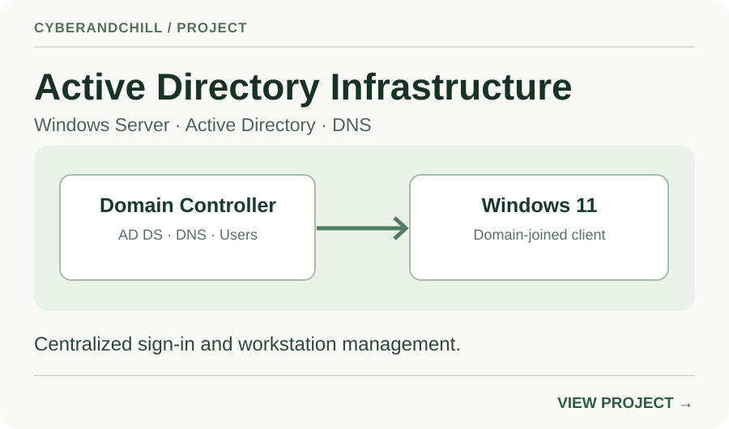
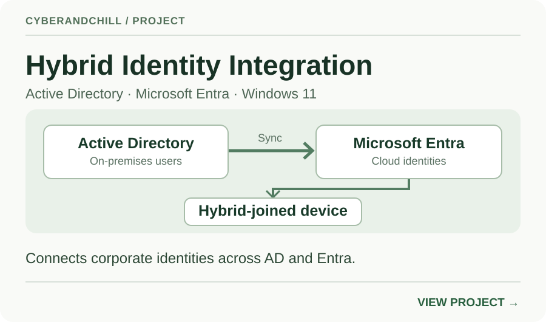

# CyberAndChill | Technical Portfolio

**Identity Engineering · IT Infrastructure · Security**

I build and validate practical IT environments that demonstrate how enterprise technology works—from directory services and workstation management to hybrid identity.

This portfolio shows the architecture, problems solved, and verified outcomes behind each project. Open a project to explore its results, screenshots, and a step-by-step manual walkthrough.

## Selected projects

### Build 30 for 30

A growing collection of hands-on IT projects. Each build demonstrates a technical use case and a working result.

---

**Building your own portfolio?** [See how to structure a project for your résumé or job applications](docs/START-HERE.md). Show what you built, what problem it solved, and how you verified it.
