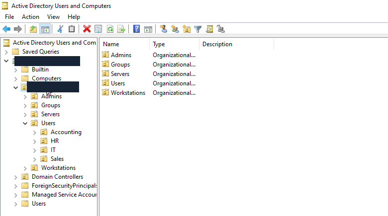

# Active Directory Lab: Build, Join and Verify

**✓ Verified** · [CyberAndChill Portfolio](../../README.md)

## What I built

Built an isolated Windows Server domain and joined Windows 11; verified 14 users, 5 groups, device trust and administrator separation.

## Why it matters

Centralize user sign-in and onboard a workstation while preserving the existing environment.

## Architecture

## Rebuild it yourself

[**Follow the manual GUI walkthrough →**](GUIDE.md)

The guide gives numbered GUI clicks, settings, useful original screenshots and expected results. An extended technical reference is available when needed.

## Result

Verified against October 21 implementation evidence: controller diagnostics passed, all 14 created users were enabled with requested non-expiring account/password settings, and the client passed trust, DNS, SYSVOL and endpoint-security checks. Both administrator roles and a standard role authenticated; only the administrators had elevation capability. One real administrator desktop sign-in was observed. The 13-page private guide and phone-accessible private handoff were delivered. Publication review on October 22 did not rerun or alter the infrastructure.

**Technologies demonstrated:** Windows Server 2022, Windows 11 Pro, Active Directory / DNS, PowerShell

Technical evidence, validation and troubleshooting

**Checks:** 10/10 passed in the recorded implementation. Original evidence is historical, not a new health check.

**Evidence:** A selection of original screenshots is included in the manual walkthrough.

**Limitations:** This was a controlled lab validation, not a production deployment.

[Additional notes](NOTES.md). This README is generated by `tools/render.py`.
