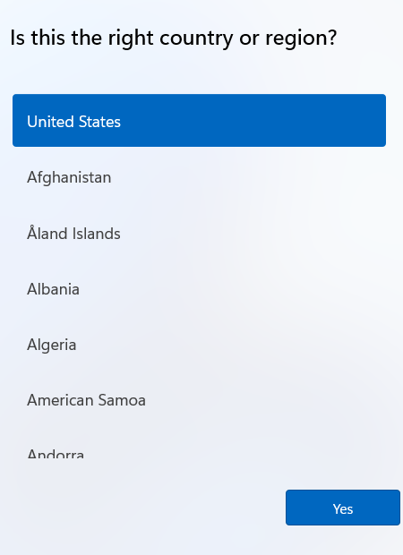
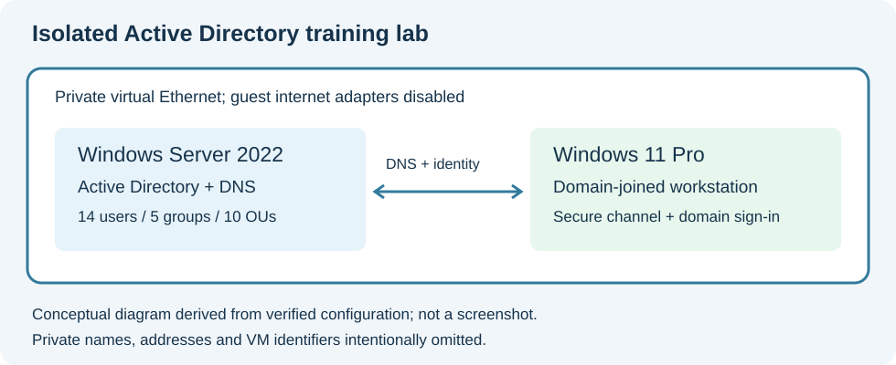
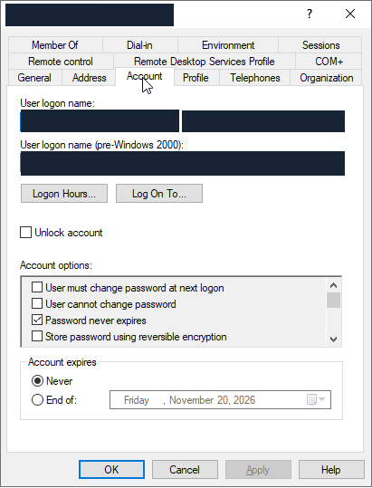
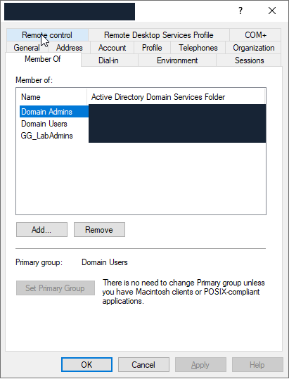
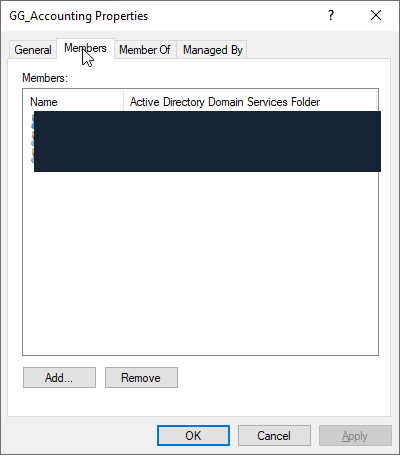
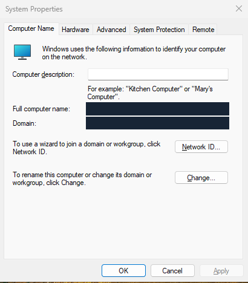
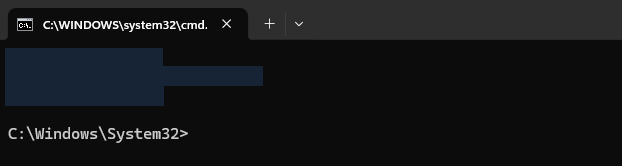

# Build story: an isolated Windows identity lab

**Implementation:** October 21, 2026, America/New_York. Some UTC verification timestamps fall on October 22. **Publication review:** October 22, 2026. This entire conversation is one challenge day. Verification below describes the implementation session, not a fresh test of the running lab on publication day.

## Objective and business use

Build a separate Windows Server domain controller, join a Windows 11 client, organize users and groups, and prove that selected administrators can manage the environment while ordinary users stay unprivileged. This models a small organization's central identity and workstation onboarding workflow. Produce explanations a beginner can follow, genuine screenshots, and a diagram.

The owner requested autonomous completion, reuse of an existing approved password privately, non-expiring practice accounts, preservation of the existing lab, and documentation without repeated setup questions. The public [request and conversation scope](request-and-scope.md) preserves that story with the private namespace removed.

## Starting point

There was no deployed instance of this requested separate domain at the start. Existing generalized Windows Server 2022 Standard Evaluation and Windows 11 Pro templates were available on Proxmox/QEMU. Existing unrelated lab guests and their configurations had to be preserved. Each new linked clone received two virtual CPUs, 4 GiB RAM and a 64 GiB virtual system disk. Linked clones depend on their template backing disks.

The Windows client began in out-of-box experience (OOBE), not at a ready-to-use domain desktop:

No existing AD infrastructure, cloud tenant changes, license purchases or unrelated projects are accomplishments of this entry.

## Chronological implementation

### 1. Review the existing automation and prerequisites

Read the lab maintenance instructions and reused the existing Ansible playbooks, guest-agent helpers and encrypted-keyring flow. Checked the templates, device identity, mounted destination filesystem, free disk space, available memory and current guest inventory through Ansible. Runtime-only guest credentials were obtained from the already approved encrypted keyring without printing or embedding them. Recorded configuration hashes for eight unrelated guests before cloning.

Created only the requested Server and Windows client. The new guest ownership markers and IDs were checked before configuration. No host reboot, host authentication change, partitioning or physical-network change was part of the build.

### 2. Complete Server setup and install the identity services

The first provisioning launch happened before the Server guest agent was ready. A ping was not sufficient proof that guest command execution was ready throughout first boot. Read the actual console, completed regional/license/Administrator setup with the approved password privately, added a first-boot wait, and then continued. These failed launches were not counted as successful provisioning.

Installed AD DS, DNS and management tools, named the new server, and created a single-domain forest in the requested private namespace. The recovery-mode password was supplied privately at runtime. Restarted only that guest, registered DNS and checked the directory services, shares and controller diagnostics.

### 3. Connect only the two new guests

Added a private virtual Ethernet link using a QEMU Unix-domain socket. The controller hosts the socket, so it starts before the client. Assigned a static controller address and configured the client to use the controller for DNS. Disabled guest internet/NAT adapters to avoid the controller publishing an unrelated interface address and to keep this practice network isolated. This used guest configuration and VM arguments, not a physical bridge or host-network redesign.

After the network-adapter restart, an early guest command timed out. A read-only network inspection showed that the intended private configuration had not been applied. An AD module import then failed while services were still starting. Added a read-only domain-services readiness check before configuration; the subsequent private-LAN configuration succeeded. Diagnosed the state before retrying.

### 4. Organize the directory and separate privilege

Created ten OUs: a training root; Users, Admins, Groups, Workstations and Servers containers; and four department OUs under Users. Created twelve ordinary department accounts and two administrator accounts. Added four department security groups and one administration group. Department groups each contain three ordinary accounts; the administration group contains the two administrators.

Initially used nested admin-group membership, then made the two administrators direct Domain Admins and explicitly placed the administration group in the client's local Administrators group. Both mechanisms are disclosed rather than implying a narrower delegated join-only role. No Enterprise Admins membership was added to the two new administrators.

The owner explicitly requested non-expiring account/password settings. All fourteen created accounts were enabled, had account expiration cleared and Password never expires enabled. Windows rejects Clear-ADAccountExpiration on its built-in Administrator account. The script was corrected to check that built-in account's existing non-expiring state instead of trying to change its protected expiration field. A rerun reused the created accounts rather than duplicating them or resetting their passwords.

### 5. Join the client and recover its first-start identity

Configured the client private address and controller DNS. Joined it using one of the new administrator accounts and placed the AD computer object in Workstations. Avoided passing a NewName parameter when the requested name was already set. Corrected the network step to skip an already disabled adapter; Set-DnsClient cannot query a disabled adapter's DNS object as though it were still active. The secret-bearing operations stayed under Ansible no_log.

OOBE subsequently assigned another generated local computer name. That disagreed with the computer account already created in AD, breaking the trust relationship. Inspected the membership and names, restored the exact registered computer identity, corrected the local setup-completion state and restarted the owned client. An early registry helper used New-Item -Force on an existing OOBE key and failed; it was changed to create the key only when absent. The eventual recovery also restored ActiveComputerName. This is a documented workaround for this clone's interrupted setup, not a universally recommended first-start process.

After confirming the expected name and private adapter, repaired the owned client's machine-account trust with runtime credentials where required. This did not reset any user's password. The final secure-channel test returned True. The temporary setup account was disabled and automatic setup login was turned off.

### 6. Validate credentials, privilege and an actual desktop

Used Windows LogonUser with interactive logon type to validate two administrator accounts and one ordinary account. The first role check incorrectly evaluated only the unelevated token, so it reported failure for an administrator while UAC was enabled. The corrected script inspects the linked elevated token when present. Both administrators then had administrator capability; the ordinary account did not. UAC remained enabled. This correction validates the test's handling of UAC, not a claim that UAC was disabled or bypassed.

Console login initially failed because rapid emulated keystrokes dropped leading username characters. Read the nonsecret username field, slowed the typing and confirmed it before submitting the password privately. A real domain-administrator Windows desktop then opened. Captured genuine hostname, whoami and logon-server command output. The public crop masks those identifier-bearing lines rather than inventing replacement output.

Only one account was observed in a graphical desktop session. The other administrator and ordinary account were tested using the Windows interactive-logon API, not separate GUI sign-ins.

### 7. Deliver a beginner handoff and resolve phone access

Created a 13-page PDF, HTML guide, six final screenshots, SVG diagram, companion ZIP and measured JSON reports. The guide explains domain controllers, DNS, OUs, groups, local/domain identities, startup order, normal use and the actual troubleshooting. Checked page count, image completeness, ZIP integrity, delivery-byte identity and absence of the actual private password. Verified all eight unrelated guest configuration hashes still matched. Left the two new guests running.

The owner's remote phone session could not access sandbox download links. Uploaded private copies of the existing PDF and ZIP to the connected Google Drive and verified their metadata and unshared status. Added a text handoff containing the exact original request and an explicit warning that the lab already exists. Those private URLs, cloud file IDs, original PDFs/ZIPs and full infrastructure handoff are excluded from this public repository.

## Reproduction guide using public examples

The following is a manual reference based on the executed procedure. [Example values](../configs/example-values.json) use a reserved documentation namespace and TEST-NET addresses. They are not the actual lab endpoints and this sanitized variant was not independently replayed.

1. Create two fresh Windows guests from preserved, generalized templates. Keep the template backing disks for linked clones. Complete first-start setup before depending on unattended joins. Confirm their guest agents can execute commands, not just respond to ping.
2. On the Server guest, assign a static address, install the roles with `Install-WindowsFeature AD-Domain-Services,DNS -IncludeManagementTools`, choose the server name and restart. Create the forest with `Install-ADDSForest`, supplying a SecureString for the recovery-mode credential privately. Restart and wait for NTDS, DNS, ADWS, Netlogon and KDC.
3. Connect the controller and client to a private virtual Ethernet segment. Set client DNS to the controller. Ensure the controller registers only its intended private interface. A QEMU socket network must start its server endpoint before its client endpoint.
4. Use `New-ADOrganizationalUnit`, `New-ADUser`, `New-ADGroup` and `Add-ADGroupMember` to implement the documented containers and roles. Supply account passwords as SecureString values from a private runtime input. For the explicitly requested practice policy, set PasswordNeverExpires and clear expiration on created users; preserve built-in account restrictions. Do not reproduce this shared/non-expiring privileged-password policy in production.
5. Join the client using `Add-Computer -DomainName training.example.test -OUPath 'OU=Workstations,OU=Training,DC=training,DC=example,DC=test' -Credential $credential`. Use a unique computer name; only pass NewName when it changes. Restart and compare the local identity with the AD computer object. Prefer finishing OOBE first to avoid the recovery encountered here.
6. Validate with `dcdiag /test:Advertising /test:Services /test:SysVolCheck /test:NetLogons /test:DNS /DnsBasic`, `Resolve-DnsName`, `Test-ComputerSecureChannel` and SYSVOL access. Confirm Defender is running and all firewall profiles are enabled. Check ordinary and administrator roles separately.
7. [Test-ExampleClient.ps1](../scripts/Test-ExampleClient.ps1) and [Test-ExampleLogonRoles.ps1](../scripts/Test-ExampleLogonRoles.ps1) are sanitized adaptations of the maintained scripts executed here. They demonstrate the assertions and linked-token correction. Replace the public example identities in your own authorized lab. Never put credentials in source, command arguments, reports or Git history.

## Proof and limits

The [measured-results extract](measured-results.json) is allowlisted from the original reports and contains explicit checks, timestamps, booleans and counts. The [image provenance](image-provenance.json) binds retained source hashes to the final cropped/redacted PNGs and records redaction rectangles. Hashes identify bytes; the source reports and screenshots were also inspected against the conversation. Historical hashes do not prove a fresh lab-state check.

The seven published screenshots comprise six final retained screenshots plus one earlier setup screenshot. Interim promotion screens and several troubleshooting displays were overwritten by later console captures; those original images are an evidence gap. The troubleshooting sequence is supported by the available conversation and maintained-script history, not reconstructed screenshot claims. No infrastructure was changed or reprovisioned for publication.

Remaining limits: one controller and one client, no high availability or recovery exercise; evaluation media does not become permanently licensed because AD accounts do not expire; no Entra join, SAML application, internet/public DNS or cross-hypervisor certification; no independent replay of the public sanitized script variants. These are documentation files and examples, not VM backups. The public objective is the working on-premises domain lab, with these limits disclosed.

## Lessons learned

- Bootstrap readiness requires usable services and guest command execution; a ping alone is insufficient.
- DNS and a stable matching computer identity are essential to AD trust.
- Treat ordinary-token and linked elevated-token checks differently when UAC is enabled.
- Diagnose failed operations before retrying; idempotent account creation prevents duplicate users and accidental password resets.
- Keep source evidence immutable, redact public copies deterministically, and distinguish a diagram from a native screenshot.
- Test delivery through the owner's actual access channel. A local download link was insufficient for the remote phone session; private cloud delivery solved it without publicizing the lab guide.

## Portfolio publication review

All thirty records were read before selecting Day 01; every slot was still planned. A commit-pinned checkout was compared against all 250 remote Git blob hashes. Only Day 01 source/artifacts and its generated landing-page/day README are changed; NOTES.md, the renderer and the other 29 days are preserved.

The unchanged renderer and its `--check` both pass on the updated portfolio. The starter's optional `test_render.py` initially failed one test because `test_verified_without_evidence_rejected` only changes Day 01's status to verified and assumes its input record has no evidence. A legitimately completed Day 01 no longer supplies that empty fixture. All six unchanged tests passed against an isolated copy of the original planned-project baseline, using byte-identical renderer/test code. This is a disclosed test-fixture limitation; it is not a failed AD check and no passing test output was invented. Updating the repository-wide fixture was kept outside this day's publication scope.

The public copies were checked for private names, addresses, logon identities, the actual password and private cloud links. Every final PNG was visually reviewed. [Publication review](publication-review.json) records the distinction between historical lab checks and current documentation checks. No new screenshots were staged as if they came from the original build, and no lab guests were modified for publication.
