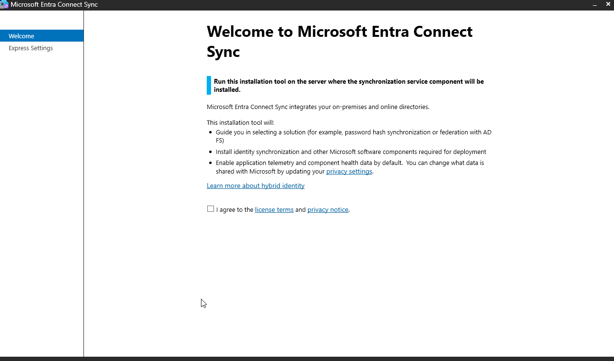
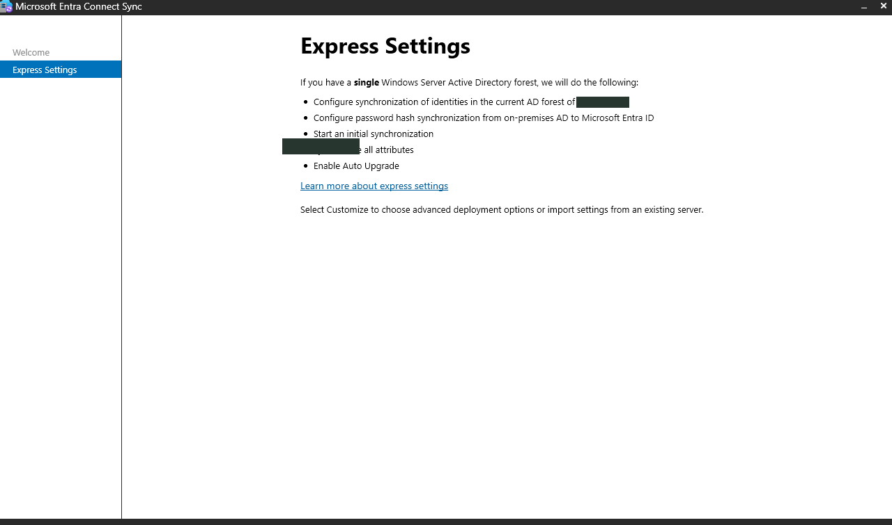
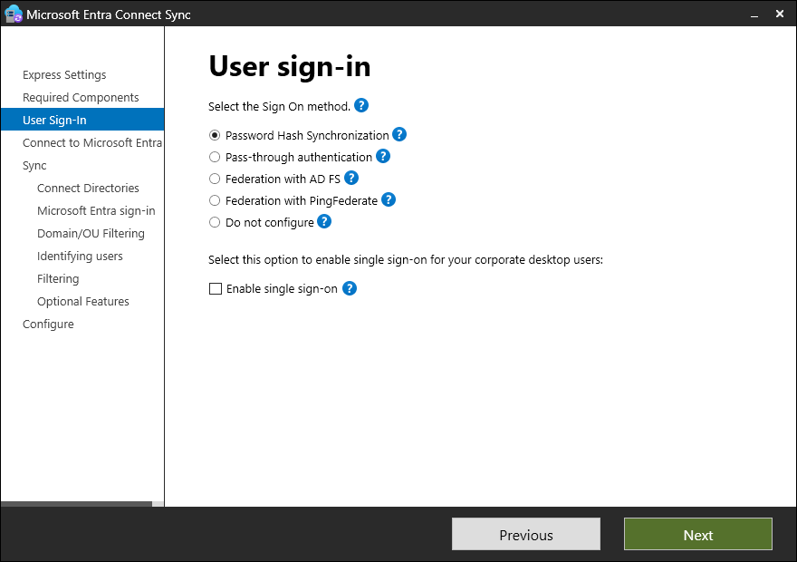
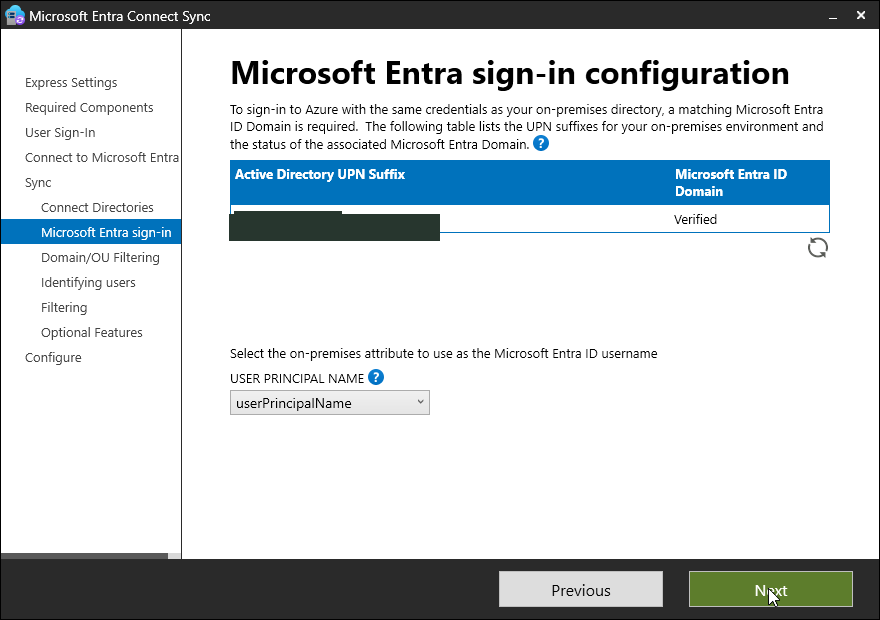
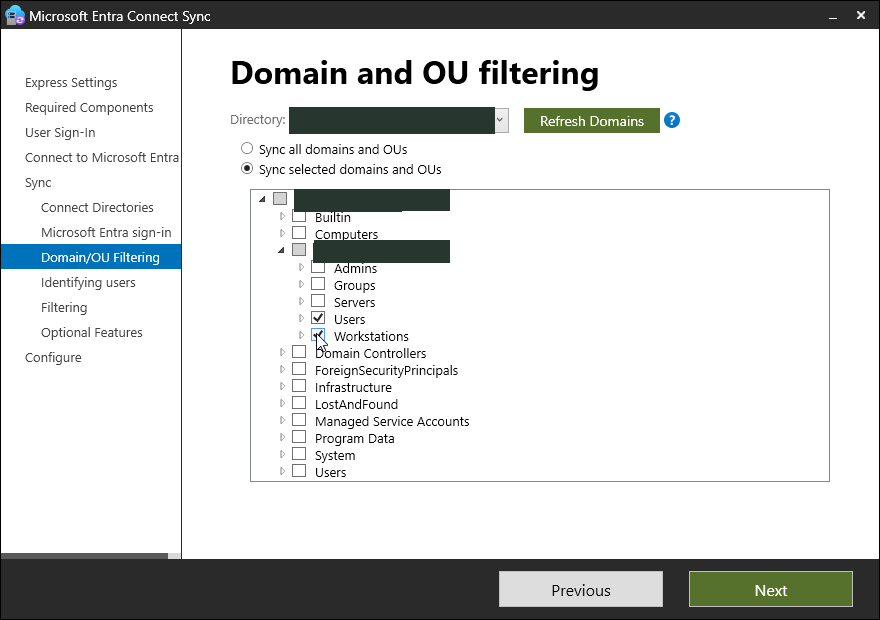
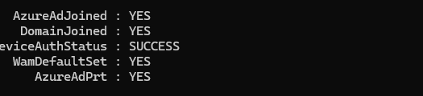

# Hybrid Identity — Manual Setup Guide

**Goal:** Synchronize selected AD users to Microsoft Entra ID and validate a hybrid-joined Windows 11 Pro device. These are manual instructions using example settings; adjust them to your environment.

## Prerequisites
Complete the [Active Directory lab](../day-01/GUIDE.md). You need a working AD domain and joined client, an Entra tenant with a **verified domain you own**, a suitable cloud administrator role (such as **Hybrid Identity Administrator**), supported Windows Server resources, and outbound access to Microsoft services. Check current Microsoft Entra Connect Sync requirements first. Preserve an independent cloud-only admin account.

## Step 1 — Confirm the Entra tenant
1. Sign in to **https://entra.microsoft.com** with the authorized cloud administrator.
2. Navigate to **Identity → Settings → Domain names**; confirm that your own routable domain is verified.
3. Under the hybrid identity/Entra Connect area, inspect existing synchronization before setting up a new sync server.
4. Confirm user UPNs, selected OUs and potential duplicate cloud accounts.

**Verify:** The domain is verified, the intended user scope is known and no existing sync deployment is being overwritten.

## Step 2 — Install Entra Connect Sync
1. Download the current Microsoft Entra Connect Sync installer through Microsoft.
2. Sign in to the designated Windows Server and launch the official signed installer.
3. Accept the license and select **Customize** instead of Express Settings.
4. Continue with the required components; follow supported options for your environment.

**Verify:** The customized setup wizard advances to sign-in configuration.

## Step 3 — Select authentication and connect directories
1. On **User sign-in**, select **Password Hash Synchronization** for this lab.
2. On **Connect to Microsoft Entra ID**, sign in with the authorized tenant administrator when prompted. Complete MFA privately.
3. On **Connect your directories**, add the on-premises AD forest with an authorized account and use the supported service account configuration.
4. On **Microsoft Entra sign-in configuration**, confirm the verified domain/UPN alignment.

**Verify:** The wizard recognizes both directories without errors.

## Step 4 — Restrict OU scope
1. In **Domain and OU filtering**, choose **Sync selected domains and OUs**.
2. Check only the two intended training OUs containing the standard user population.
3. Leave privileged, built-in and unrelated identities out of scope.
4. Continue through optional features, source anchor and readiness screens, reviewing the selected settings.

**Verify:** The review screen lists the intended configuration. Do not enable broad syncing unintentionally.

## Step 5 — Configure hybrid device registration
1. In the Connect configuration flow (or by rerunning its configuration wizard), select the supported **Configure device options** path.
2. Select **Configure Microsoft Entra hybrid join** for the appropriate Windows device type and forest.
3. Complete any required service connection point configuration using authorized credentials.
4. Confirm the client can resolve its on-premises domain and reach Microsoft device-registration endpoints.
5. Finish setup and allow sync/registration to complete; reboot the client if required.

**Verify:** The Windows device is still joined to on-premises AD and is registered in Entra as a hybrid-joined device.

## Step 6 — Validate the lab
1. In the **Entra admin center → Users**, confirm the expected synchronized lab users exist.
2. Under **Devices → All devices**, locate the exact lab client and confirm its hybrid join state.
3. Sign in to Windows 11 as a synchronized standard user.
4. Open Command Prompt, run `dsregcmd /status`, and inspect **DomainJoined**, **AzureAdJoined**, and the **AzureAdPrt** field under the signed-in user context.
5. Restart the server/client as appropriate and verify that sync and registration persist.

**Original outcome:** Twelve users synchronized and 23 acceptance checks passed. A valid PRT demonstrates token acquisition, not successful sign-in to every cloud app.

