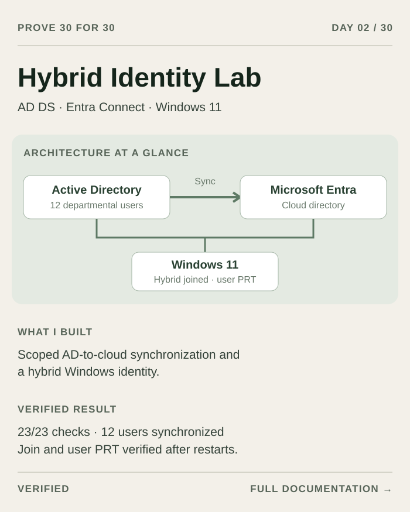

# Day 02 build story — Hybrid Identity: AD to Microsoft Entra

This day extends the previously completed [Day 01 AD lab](../../day-01/README.md). It does not claim to rebuild that domain, repeat unrelated IAM exercises, deploy SAML, or complete the earlier phone-login project. The source is this conversation and its saved native captures, scripts and verification records. Work finished October 22, 2026 in America/New_York; the final evidence timestamps are October 23 UTC. Publication checks are separate from the implementation checks.

## Request and starting point

The owner requested Microsoft Entra hybrid join for the existing Windows 11 client, synchronization from its AD domain controller, use of the existing cloud administrator, reasonable defaults and autonomous completion. They also requested documentation and screenshots so a person could reproduce the work manually. An early clarification established that “Codex account” meant the Entra administration user, not the Codex application account.

The owner wanted access to survive reboots. The implementation separates three things: an encrypted delegated automation cache, the unattended sync service identity, and a person's Windows desktop sign-in. No Windows automatic login was configured, and no permanent exemption from Microsoft authentication policy was promised.

The starting lab already had a Windows Server 2022 AD/DNS controller and a domain-joined Windows 11 Pro client, twelve departmental accounts, two lab administrators, five groups and ten owned OUs. The original AD build remains Day 01. Eight unrelated guest configurations and the golden templates were preserved.

## Architecture and final configuration

| Component | Actual implemented role / allocation |
| :--- | :--- |
| AD controller / sync server | Windows Server 2022; 2 vCPUs, increased to 6 GiB RAM / 80 GiB owned overlay |
| Windows client | Windows 11 Pro; 2 vCPUs, 4 GiB RAM / 64 GiB disk |
| Private LAN | Existing QEMU UNIX-socket Ethernet; AD DNS and domain authentication retained here |
| Outbound access | Separate existing QEMU NAT adapter in each guest; no physical network bridge or host networking changes |
| Sync engine | Microsoft Entra Connect Sync 2.6.92.0; password hash synchronization |
| Population | Exact Users and Workstations OUs; twelve department users plus the owned client |
| Privileged accounts | Cloud administrator remains cloud-only; AD admin containers excluded |
| Source anchor | Wizard default ms-DS-ConsistencyGuid |
| Service identity | Application identity with service certificate; ADSync automatic service |
| Device | Domain joined + Entra joined; enabled cloud ServerAd device matched to owned local device |
| Delegated automation | MSAL read-only Graph scopes User.Read and Directory.Read.All; encrypted existing GNOME Secret Service keyring |

The controller hosts Connect in this small training environment. This is not a claim of a production HA or least-resource design. A production design should assess a dedicated supported synchronization server, lifecycle, access controls, backup and capacity. No paid compute/storage or paid API service was added.



The diagram explains the relationship; it is not implementation evidence. Actual native screenshots appear in the [manual](MANUAL.md), with source hashes and privacy edits recorded in [image provenance](image-provenance.json).

## Chronological implementation

### 1. Inspect current state and authentication

Read-only discovery confirmed the intended cloud user and direct Hybrid Identity Administrator role, the verified custom domain, and a managed tenant. Application Administrator and Intune Administrator were also present but were not a substitute for checking the hybrid role. The tenant already reported directory sync enabled with an old last-sync timestamp, so the work did not disable tenant sync or remove previous cloud objects. None of the twelve target departmental UPNs collided with existing Entra accounts.

A maintained MSAL helper ran as the existing desktop user. It verified Graph `/me` against the expected account before storing the serializable token cache in the existing encrypted GNOME keyring. No plaintext fallback was added. A fresh helper process forced a silent token refresh and verified keyring readback. The scopes are read-only inventory permissions; this cache is not claimed to authorize arbitrary Entra writes.

The user completed private Microsoft authentication. Passwords, MFA values, device codes, tokens and cache contents were excluded from documentation and captures. After a host reboot, normal desktop sign-in/keyring unlock remains necessary; policy, revocation or MFA can still require authentication. The host was not rebooted to test that path. See [persistent access notes](PERSISTENT-ACCESS.md).

### 2. Add bounded guest outbound connectivity

Both guests retained the private domain LAN and private DC DNS. Their existing isolated NAT adapters were enabled for outbound Microsoft endpoints. The client NIC was disabled in Plug and Play (code 22), so a normal network-only check initially showed it as absent. Enabling the exact VirtIO device resolved that state. DHCP then left an APIPA address; a static address matching that guest's QEMU NAT network restored outbound access.

Both guests can use the same NAT address because each has a separate slirp network. DNS remained pointed at the private controller. NAT DNS registration was disabled. This was not a host bridge, host route/firewall change or inbound internet exposure.

The now-multihomed controller needed additional DNS care. Its DNS service listening/publishing address was restricted to the private LAN. Netlogon A-record registration was disabled, with domain-root and global-catalog A records explicitly maintained at the private address; SRV registration remained active. Unwanted NAT A records were removed. Authoritative DNS and DNS-only queries verified the result. A local fallback resolver result was not treated as proof of the zone contents.

### 3. Download, verify and size the owned server

Older provisioning-agent links returned HTTP errors or HTML rather than a signed installer. Those payloads were rejected and never executed. The final Connect Sync MSI came from Microsoft's distribution endpoint. It was a real MSI, its Authenticode status was **Valid**, its publisher was **Microsoft Corporation**, and the installed version was **2.6.92.0**.

The original 4 GiB / 64 GiB allocation was below the Connect baseline used for this run. Only the owned controller overlay grew to 80 GiB, and its final C: partition was extended after checking disk/partition identity. Controller RAM increased to 6 GiB and that guest restarted to apply it. Golden images, other guests and host partitions were preserved. Installation media was transferred over a temporary loopback-only server, which was closed afterward. Installer binaries are not in this public repository.

### 4. Use the custom Connect wizard

The wizard path was: license → Customize → default local components → Password Hash Synchronization → private Entra sign-in → add the owned AD forest with a newly created dedicated connector account → verified UPN suffix → selected OUs → default source anchor → all eligible users/devices inside those OUs → minimal optional features → initial staging mode.

The user completed Connect's own Microsoft sign-in, separate from the read-only Debian automation cache. A temporary privileged AD credential let the wizard create its dedicated AD connector account; it was supplied privately through the approved keyring flow rather than embedded in scripts. The cloud administrator was not converted into a synced AD account.

Only the Users and Workstations OUs were selected. Admins, Groups, Servers, Domain Controllers and default containers remained excluded. The “all users and devices” option applied within the selected OUs; it did not undo OU filtering. Source anchor remained the wizard-managed ms-DS-ConsistencyGuid. Password hash synchronization was selected; pass-through authentication, federation, writeback and Exchange-related features were left off. The separate Seamless SSO checkbox was not used for this modern Windows 11 PRT path.

### 5. Inspect staging, configure discovery and activate

The staged cloud export plan was **13 additions, zero updates and zero deletions**. OU selection and connector identity were read back before activation. The connector identity type was **Application** and a service certificate was present.

The owned forest SCP was configured for the intended managed tenant and read back with an explicit tenant match. An initial PowerShell array-formatting error in the owned keyword value was corrected after inspecting the exact state. The helper refused unrelated pre-existing values. The client used its native Workplace Join / Automatic-Device-Join task; an intermediate pending state before computer export was expected, not counted as success.

Activation used the supported Connect wizard: Configure → Configure staging mode → cached account selection/private authentication as needed → clear staging mode → Configure → finish and exit. The implementation did not set the staging-mode property directly through PowerShell. Exiting the wizard allowed the scheduler to resume.

### 6. Export, match the device and verify an actual user

Twelve department users showed an on-premises synchronization source. The client task completed successfully after the computer export. Local state was DomainJoined YES, AzureAdJoined YES and DeviceAuthStatus SUCCESS in the intended tenant. The exact cloud object was matched using a device-ID hash inside the verification flow; raw tenant/device IDs were not exported to the public evidence. Cloud trust type was ServerAd and the object was enabled. Exact device ownership remains in a protected local guest ledger, not this repository.

A client machine-trust problem was repaired for the owned machine. An immediate PowerShell test was stale; native `nltest /sc_verify` refreshed verification, after which secure channel and SYSVOL checks passed. No established user password was reset.

The standard departmental user then signed into the real desktop. The user-context probe verified that it was not SYSTEM and did not have an elevated administrator token. It returned AzureAdPrt YES and WamDefaultSet YES. A SYSTEM `dsregcmd` result is not adequate proof of a human user's PRT. The screenshot filter was tightened to exact keys so authority URLs and tenant identifiers would not enter the evidence image.

### 7. Test persistence, finish delta confirmation and document

The controller restarted after active configuration. Before anyone signed into its desktop, ADSync was Running with automatic start, retained the application certificate, and accepted a delta-sync request. The client also restarted after joining. Its hybrid device state persisted and, after normal standard-user sign-in, a fresh PRT was confirmed.

Twelve AD source-anchor updates initially remained unconfirmed exports. Inspection showed populated attributes and no connector-space sync/export errors. One maintained delta cycle confirmed them. The final inspection showed zero pending additions, updates and deletions on both connectors, staging disabled, scheduler enabled/unsuspended and no sync in progress.

An asynchronous cache-refresh check initially raced the metadata copy. The completed fresh-process metadata was collected before final acceptance. All **23/23** checks then passed. Original directory counts and security settings remained intact, and all eight unrelated guest configuration hashes matched their baseline. Both owned guests were left running.

A private 27-page illustrated manual, sixteen native screenshots, SVG map and HTML/evidence ZIP were produced. Their links, nonblank pages, portable text and delivery-copy bytes passed QA. Those private deliverables contain environment-specific identifiers, so they are not blindly uploaded here: this public day contains sanitized examples, measured extracts and redacted native captures instead.

## Commands and automation used

Host, VM, desktop and screenshot interactions ran through maintained Ansible playbooks/helper scripts; workspace source maintenance and playbook invocation were the allowed direct operations. Guest passwords came from the approved encrypted keyring with `no_log` consumers. Routine status did not reprovision the lab.

The actual workspace used `cyber-chill-entra-auth*.yml`, `cyber-chill-hybrid-*.yml` and the maintained domain preservation/trust helpers. Helper roles included outbound network configuration, DNS publishing, signed installation, resource inspection/resize, SCP setup, staged review, sync inspection, client registration, user proof and post-reboot service verification. The public [PowerShell adaptations](../scripts/) preserve useful verification logic with private values replaced; they were not separately executed in placeholder form.

Typical playbook entry points, run from the workspace's `ansible` directory:

```sh
ansible-playbook playbooks/cyber-chill-entra-auth.yml -e entra_auth_operation=verify
ansible-playbook playbooks/cyber-chill-entra-auth-status.yml
ansible-playbook playbooks/cyber-chill-hybrid-cloud-check.yml
ansible-playbook playbooks/cyber-chill-hybrid-validate.yml
ansible-playbook playbooks/cyber-chill-hybrid-guide.yml
ansible-playbook playbooks/cyber-chill-hybrid-render.yml
ansible-playbook playbooks/cyber-chill-hybrid-package.yml
```

These names document the executed private workspace workflow, not a claim that this public folder ships a complete infrastructure deployer. Use the [manual walkthrough](MANUAL.md) for reproduction without the original hypervisor or private workspace.

Useful native verification commands (substitute your own verified domain/server; example names are not the actual environment):

```powershell
Get-AuthenticodeSignature .\AzureADConnect.msi
Get-FileHash .\AzureADConnect.msi -Algorithm SHA256
Resolve-DnsName EXAMPLE-DC.example.com -Server 192.0.2.10 -DnsOnly -NoHostsFile
nltest /sc_verify:example.com
Test-ComputerSecureChannel -Server EXAMPLE-DC.example.com
Import-Module ADSync
Get-ADSyncScheduler
Start-ADSyncSyncCycle -PolicyType Delta
Get-Service ADSync
Get-ADSyncEntraConnectorCredential | Select-Object ConnectorIdentityType
```

Run device/user checks from the actual signed-in standard user's ordinary PowerShell window:

```powershell
whoami
dsregcmd /status | Select-String '^\s*(AzureAdJoined|DomainJoined|DeviceAuthStatus|AzureAdPrt|WamDefaultSet)\s*:'
```

Do not publish full raw device-registration output or export connector credential objects. The exact-key filter intentionally excludes identifiers and authority URLs.

## Results and limits

- [Acceptance extract](measured-results.json): 23/23 checks passed, original final verification 2026-10-23 03:26 UTC.
- [User-session proof](user-session.json): real standard interactive context, not SYSTEM/not elevated, joins YES, device authentication SUCCESS, PRT/WAM YES after client boot.
- [Service restart proof](sync-after-restart.json): automatic service startup, application certificate, no DC interactive user, successful sync request.
- [Final sync state](sync-final.json): enabled unsuspended scheduler, staging off, no pending exports or running connectors.
- Browser application SSO, licensed Word/Outlook access, host reboot and other hypervisors were **not tested**. A PRT does not prove a particular application's license or authorization.
- The delegated keyring cache needs a normal unlocked desktop session after host restart, and provider policy can require reauthentication. No permanent-access claim is made.
- No screenshots of secret authentication prompts are published. Some troubleshooting was captured as structured checks rather than an error-screen image; the chronology does not imply a screenshot exists for every command.

## Lessons learned

1. Separate browser sessions, delegated token caches, Windows sign-in and unattended sync service identity before deciding what “persistent” means.
2. Validate actual installer bytes and signatures, not just HTTP status or filenames.
3. Multihomed DCs require authoritative DNS inspection; local fallback resolution can mislead.
4. OU scope and a zero-delete staged plan are practical guardrails before activating synchronization.
5. Device join, enabled cloud device state and a real user's PRT are separate checks.
6. A successful reboot test must say which machine restarted and which user/service was verified afterward.
7. Keep private originals, publish reviewed copies with provenance, and label diagrams and sanitized script variants accurately.

## References

- [Microsoft Entra Connect prerequisites](https://learn.microsoft.com/en-us/entra/identity/hybrid/connect/how-to-connect-install-prerequisites)
- [Microsoft Entra hybrid join](https://learn.microsoft.com/en-us/entra/identity/devices/how-to-hybrid-join)
- [Connect scheduler and staging guidance](https://learn.microsoft.com/en-us/entra/identity/hybrid/connect/how-to-connect-sync-feature-scheduler)
- [Application identity authentication](https://learn.microsoft.com/en-us/entra/identity/hybrid/connect/authenticate-application-id)
- [Multihomed DC DNS registration](https://learn.microsoft.com/en-us/troubleshoot/windows-server/networking/unwanted-nic-registered-dns-mulithomed-dc)
