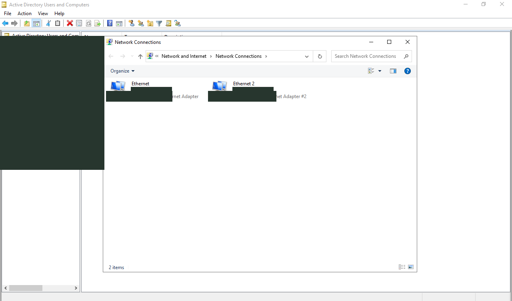
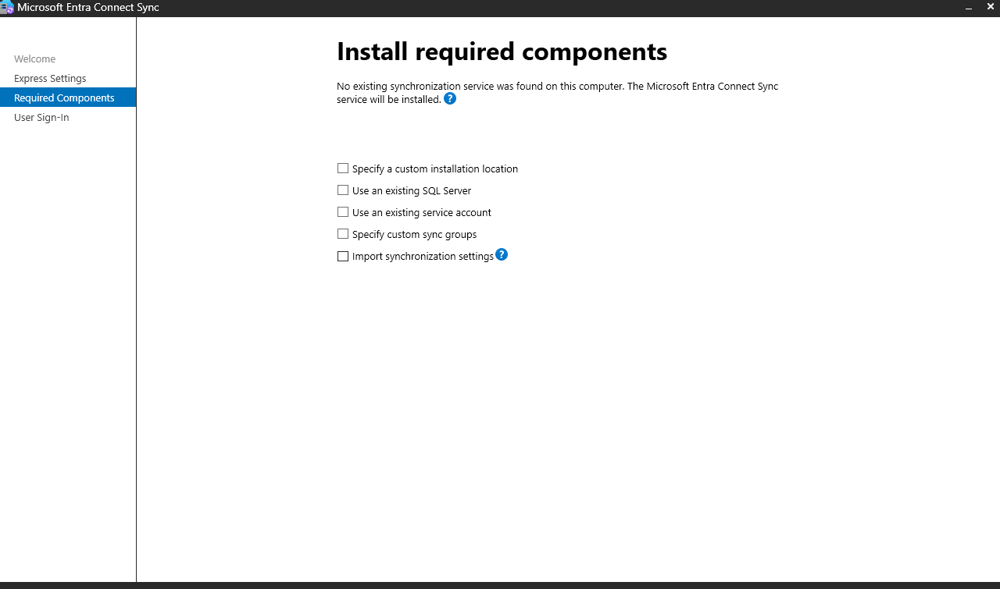
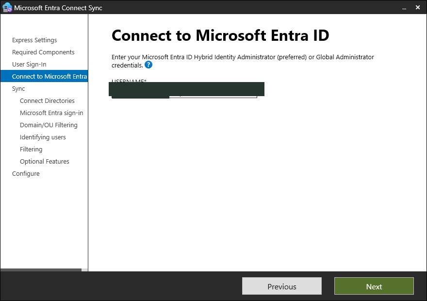
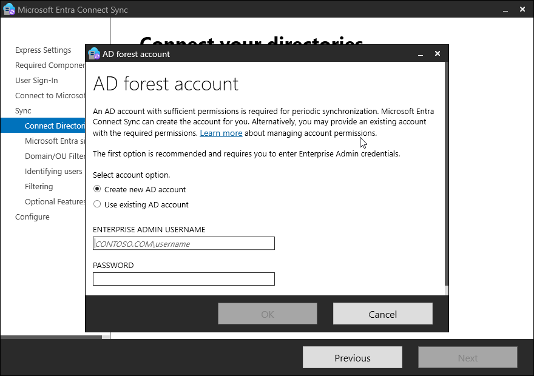
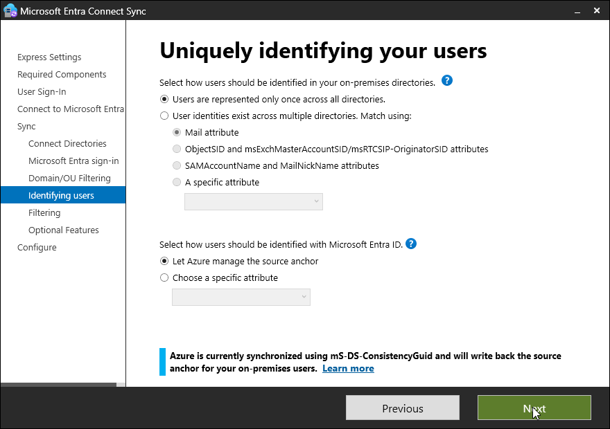
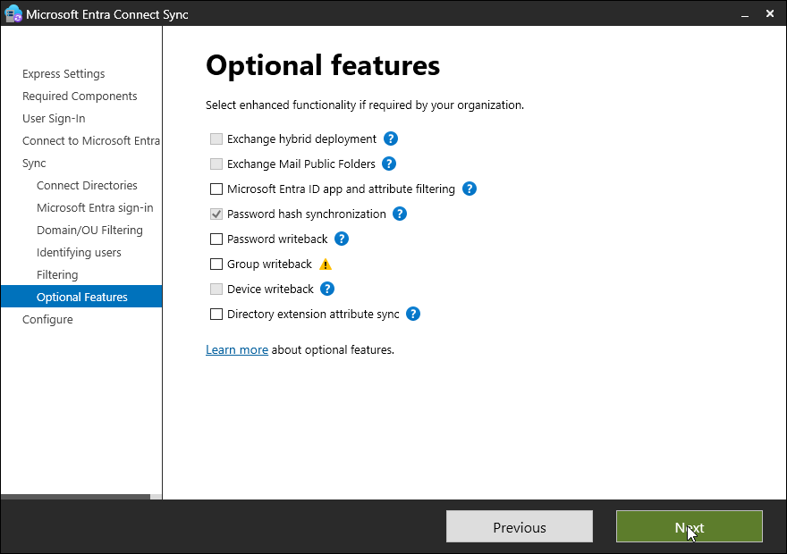
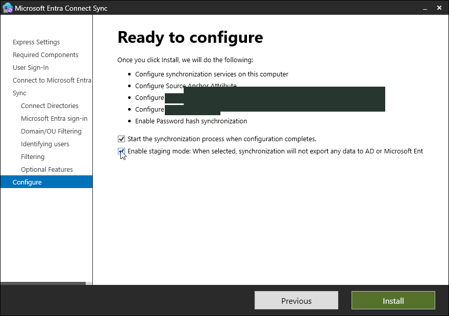
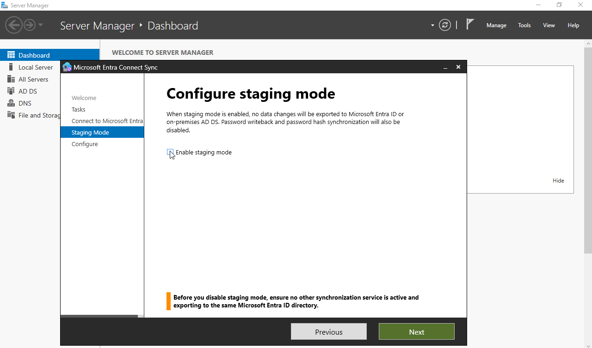
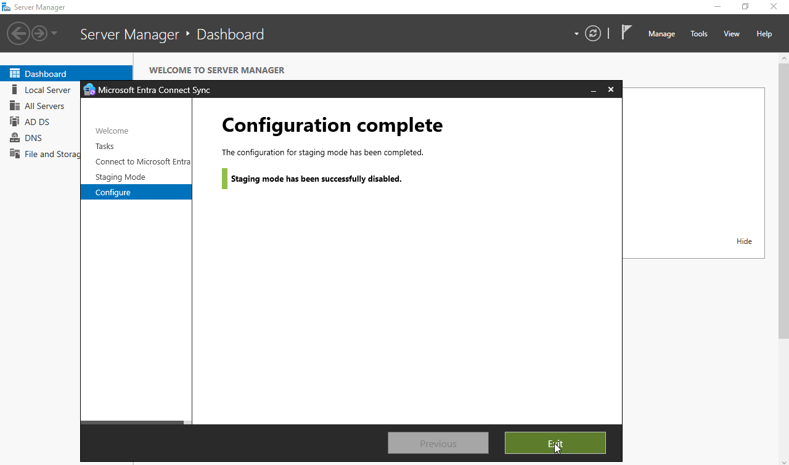
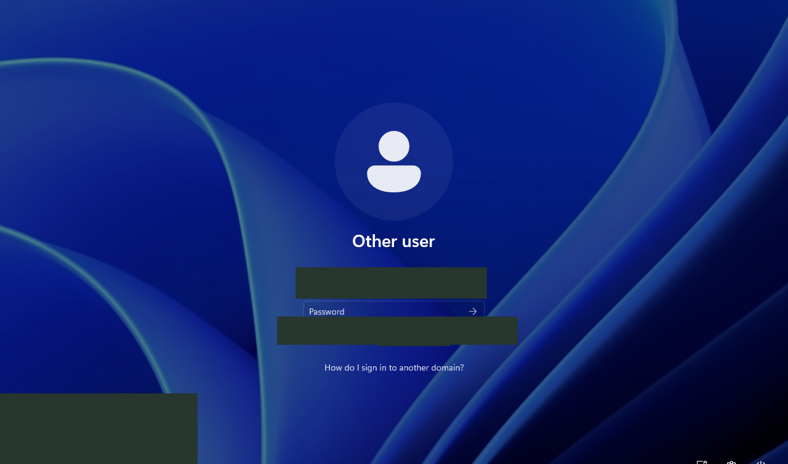

# Manual reproduction walkthrough

Adapted from the completed 27-page private illustrated guide. **All names, email addresses, addresses and local paths shown below are documentation examples, not actual endpoints.** Use a domain you own and have verified in Entra; example.com and TEST-NET addresses are not deployable lab values. Screenshot masks are privacy edits. These example substitutions were not independently replayed.


## Cyber and Chill hybrid identity lab

Verified hybrid environment


Connect the existing example.com Active Directory forest to Microsoft Entra ID and make EXAMPLE-CLIENT hybrid joined. This manual uses native Windows and Entra steps; Ansible is optional for repeating the maintained automation.


| Machine | Role | Private address | Allocation |
| :--- | :--- | :--- | :--- |
| EXAMPLE-DC, the sync server | AD DS, DNS, Entra Connect Sync | 192.0.2.10/24 | 2 cores, 6 GiB, 80 GiB disk
| EXAMPLE-CLIENT, the client | Windows 11 Pro domain client | 192.0.2.20/24 | 2 cores, 4 GiB, 64 GiB disk


The private LAN is a QEMU UNIX-socket network. Each guest also has its own outbound NAT adapter. These adapters are separate virtual networks: using 198.51.100.15 in each guest is valid. No physical network bridge or inbound internet service is required.


Keep cloud-admin@example.com as a cloud-only privileged administration account. The twelve standard departmental AD accounts are the synchronization population. lab-admin-a, lab-admin-b, built-in accounts and unrelated identities are outside the selected OUs.


Start the DC before the client. Preserve UAC, Defender and Windows Firewall. A Windows Server evaluation license remains an evaluation license after synchronization.

## 1 Verify the domain and protect sign-in


- In Entra admin center, confirm that example.com is verified under Domain names.
- Use a cloud-only account with the Hybrid Identity Administrator role assigned directly. This run verified that role on cloud-admin@example.com.
- Check existing synchronization before installing another engine. This tenant already reported directory sync enabled, with an older last-sync timestamp. Do not disable tenant sync or delete existing cloud objects to make a lab work.
- Check for username collisions. The read-only inventory found none of the twelve departmental UPNs already in Entra.
- Keep passwords, MFA, device sign-in codes and tokens out of screenshots, scripts and reports.


The Debian automation caches its own delegated access in the existing encrypted GNOME keyring. It has been tested from a new process with a forced silent refresh. After a host reboot, normal desktop sign-in and keyring unlock are required. Microsoft may require new authentication. The sync service uses its own supported identity; it does not depend on a browser tab staying open.


Detailed automation sign-in instructions: [Persistent Entra Access](PERSISTENT-ACCESS.md).

## Hybrid identity connection map

Domain DNS and AD authentication stay on the private LAN. Synchronization and device registration use outbound HTTPS.

Architecture of the two owned lab guests and the verified Entra tenant.

## 2 Prepare guest network adapters


- Open ncpa.cpl on each guest.
- Keep the private adapter on its existing 192.0.2.x/24 address, with DNS server 192.0.2.10 and no private-adapter default gateway.
- Enable the existing NAT adapter. If Windows lists it as absent while QEMU has the device, check Device Manager: code 22 means the device is disabled. Enable only that identified VirtIO device.
- Use the NAT gateway 198.51.100.2. The client in this run needed static NAT addressing 198.51.100.15/24 after DHCP left an APIPA address. Leave DNS pointed at the private DC.
- On the NAT adapter, open IPv4 → Advanced → DNS and clear Register this connection’s addresses in DNS.
- On EXAMPLE-DC, open DNS Manager → server Properties → Interfaces, and listen only on 192.0.2.10. Keep unwanted NAT addresses out of the zone and name-server address list.



Actual owned lab console screenshot. Authentication secrets are excluded.

## 3 Check private DNS and domain trust

Run these commands in Windows PowerShell on EXAMPLE-CLIENT:

```powershell
Resolve-DnsName EXAMPLE-DC.example.com -Server 192.0.2.10 -DnsOnly -NoHostsFile
nltest /dsgetdc:example.com /force
nltest /sc_verify:example.com
Test-ComputerSecureChannel -Server EXAMPLE-DC.example.com
Test-Path \\EXAMPLE-DC.example.com\SYSVOL\example.com
```


Expected: the DC resolves to 192.0.2.10, native trust status is NERR_Success, the secure-channel check is True, and SYSVOL is accessible. DNS-only checks avoid confusing local fallback resolution with authoritative DNS.


For this multihomed lab DC, DNS publishing is restricted to the private address. Netlogon A-record registration is disabled; the domain root and gc._msdcs A records are maintained explicitly at 192.0.2.10. SRV registration remains enabled. The maintained cc-hybrid-dns-fix.ps1 records the exact configuration.


If an owned client actually has a broken machine trust, repair that machine trust using a domain administrator privately. Do not reset established user passwords. Refresh native Netlogon verification before assessing the repair: this run encountered a stale immediate PowerShell result after the machine-password repair.

## 4 Obtain and validate Microsoft Entra Connect Sync


- In Entra admin center, open Entra Connect and download the Connect Sync installer.
- Copy the MSI to the owned DC. This run used Microsoft’s own distribution host and a loopback-only transfer to the guest.
- Validate the file before execution:

```powershell
Get-AuthenticodeSignature C:\ProgramData\ExampleLab\Hybrid\AzureADConnect.msi
Get-FileHash C:\ProgramData\ExampleLab\Hybrid\AzureADConnect.msi -Algorithm SHA256
```


Require a Valid signature from Microsoft Corporation. This run installed version 2.6.92.0. A successful HTTP download alone is insufficient: some older provisioning-agent links returned HTML. Those files were rejected and never executed.


Connect Sync requires at least 6 GB RAM and a 70 GB disk for a small directory. This run expanded only the sync server’s own overlay to 80 GiB and extended its last C: partition, then restarted that guest to apply 6 GiB RAM. The golden disk and host partitions were preserved.

## 5 Accept the license and choose Customize


- Run Microsoft Entra Connect Sync on EXAMPLE-DC.
- Review the license and privacy notice, accept them, and continue.
- On Express Settings, select Customize so the OU scope can be limited.

Express settings would select a wider directory scope. This lab deliberately uses custom OU selection while retaining the ordinary sign-in and source-anchor defaults.


Actual owned lab console screenshot. Authentication secrets are excluded.

## 6 Select the installation path

Select Customize. Do not import another environment’s configuration. Keep the default local installation and database choices for this small lab.


Actual owned lab console screenshot. Authentication secrets are excluded.

## 7 Install the required local components

Leave custom installation location, existing SQL Server, existing service account and custom sync groups unchecked. Select Install and wait for completion. The wizard installs its supported local synchronization components and service.

If reopening after a guest restart, the wizard may state that the service is already installed; choose Next. This is not a reason to reinstall or recreate the forest.



Actual owned lab console screenshot. Authentication secrets are excluded.

## 8 Select password hash synchronization

Choose Password Hash Synchronization. Leave pass-through authentication and federation unselected. Leave the separate Enable single sign-on checkbox unchecked for this Windows 11 hybrid-join path; the later PRT check verifies the intended modern SSO outcome.

Users continue signing into hybrid Windows with their AD account. Password hash synchronization enables the matching cloud sign-in. It does not turn a hybrid device into a cloud-only Windows sign-in device.


Actual owned lab console screenshot. Authentication secrets are excluded.

## 9 Authenticate the setup administrator


- Enter cloud-admin@example.com in the Connect to Microsoft Entra ID page.
- Select Next, then complete Microsoft’s sign-in and MFA privately.
- Wait until the wizard advances to Connect your directories.

This sign-in is separate from browser portal cookies and from the Debian Graph automation cache. Do not weaken MFA or copy tokens between applications to avoid it. Password and MFA screens are intentionally excluded.



Actual owned lab console screenshot. Authentication secrets are excluded.

## 10 Connect the owned AD forest


- Keep Directory type Active Directory and forest example.com.
- Select Add Directory.
- Choose Create new AD account. Supply an Enterprise Administrator temporarily to let the wizard create its dedicated AD connector account with the required permissions.
- This run used EXAMPLE\Administrator through the approved private keyring flow. Do not type a password into a script or command line.
- Confirm the configured directory has a green check, then select Next.



Actual owned lab console screenshot. Authentication secrets are excluded.

## 11 Confirm the verified user principal name

Confirm that example.com is marked Verified. Keep userPrincipalName as the cloud username attribute and select Next.

The departmental users already have matching AD UPNs such as standard-user@example.com. Do not invent another tenant suffix or rename the forest.


Actual owned lab console screenshot. Authentication secrets are excluded.

## 12 Limit synchronization to the intended OUs


- Select Sync selected domains and OUs.
- Clear the domain-root checkbox to remove the initial broad selection.
- Expand example.com → Lab.
- Select only Users and Workstations. Users includes Accounting, HR, IT and Sales.
- Leave Admins, Groups, Servers, Domain Controllers and default containers unchecked.
- Review the checked items before selecting Next.

Scope: twelve department accounts and the owned workstation. Administrative accounts and unrelated identities remain excluded.


Actual owned lab console screenshot. Authentication secrets are excluded.

## 13 Keep the default identity matching choices

Select Users are represented only once across all directories and Let Azure manage the source anchor. The wizard reports ms-DS-ConsistencyGuid as the source anchor. Select Next.

On Filter users and devices, keep Synchronize all users and devices. This means all eligible objects inside the selected OUs; it does not undo the OU filter. No pilot-group membership is needed for this two-guest lab.



Actual owned lab console screenshot. Authentication secrets are excluded.

## 14 Keep optional features minimal

Keep Password hash synchronization selected. Leave password writeback, group writeback, device writeback, Exchange integration, directory extensions and app/attribute filtering unselected.

Device writeback is not a prerequisite for this Windows 11 hybrid-join workflow.



Actual owned lab console screenshot. Authentication secrets are excluded.

## 15 Configure a staging run first


- Review the forest and tenant connector names on Ready to configure.
- Keep Start the synchronization process when configuration completes checked.
- Select Enable staging mode for the first inspection run.
- Select Install and wait for Configuration complete.

Staging performs imports and synchronization without exporting identity changes or password hashes. Review the selected OU scope and pending exports before switching this engine active. Do not enable a second active engine for an overlapping population.



Actual owned lab console screenshot. Authentication secrets are excluded.

## 16 Configure device registration discovery

Hybrid Windows devices need the forest service connection point (SCP) to identify the tenant. Use Connect Sync’s Configure device options → Configure Microsoft Entra hybrid join, or the documented Microsoft SCP procedure. For this managed tenant, the discovery domain is exampletenant.onmicrosoft.com.


This run configured and read back the SCP in the owned forest using the maintained cc-hybrid-scp.ps1. It verifies the intended tenant and refuses unrelated pre-existing values. Supply your own verified tenant ID privately when reproducing this in another environment.


On EXAMPLE-CLIENT, the native task Microsoft → Windows → Workplace Join → Automatic-Device-Join performs registration. A device can remain pending until Connect Sync exports the computer’s certificate and the task retries. This intermediate state is not evidence of a completed hybrid join.

## 17 Activate the reviewed synchronization scope

The staged connector planned 13 Entra additions, zero updates and zero deletions. The selected AD scope was read back and verified. The connector identity type was Application, with a service certificate present.


- Exit the completed setup wizard, reopen Microsoft Entra Connect Sync, and choose Configure.
- Under Additional tasks, select Configure staging mode, then Next.
- Use the already authenticated codex account when Microsoft presents an account picker. Complete fresh MFA privately if required.
- Clear Enable staging mode, select Next, review the change, and select Configure.
- Keep Start the synchronization process checked. Wait for completion, then exit the wizard so its scheduler can resume.

Use this supported wizard path. Setting the staging-mode property directly through PowerShell is unsupported.



Actual owned lab console screenshot. Authentication secrets are excluded.

## Activation completed

The supported wizard confirmed that staging mode was disabled and synchronization was active.



Actual owned lab console screenshot. Authentication secrets are excluded.

## 18 Verify exports and the final device state

Run an initial synchronization when required; normal later cycles are delta cycles.

```powershell
Import-Module ADSync
Get-ADSyncScheduler
Start-ADSyncSyncCycle -PolicyType Initial
```


In Synchronization Service Manager, inspect Operations and pending exports. Verify successful AD and Entra import/sync/export runs, the intended twelve users, the workstation object, and no unrelated deletions.


In Entra, verify the lab users show an on-premises synchronization source. On EXAMPLE-CLIENT, trigger Automatic-Device-Join after the computer export and check:

```powershell
dsregcmd /status | Select-String '^\s*(AzureAdJoined|DomainJoined|DeviceAuthStatus)\s*:'
```


Require AzureAdJoined : YES, DomainJoined : YES, and DeviceAuthStatus : SUCCESS. Check the exact owned device in the intended tenant. A successful task launch alone is insufficient.

## 19 Verify a real user session and retain evidence


- Sign into EXAMPLE-CLIENT using a synced standard AD account, such as standard-user@example.com.
- Run dsregcmd /status from that user’s ordinary interactive PowerShell session, rather than the guest agent’s SYSTEM session.
- Verify AzureAdPrt : YES and the expected WAM account. Optionally test browser application SSO separately; that check was not performed in this run.
- Do not claim licensed Word or Outlook access without testing it separately.
- Record the final verification time, sync status, guest power states and screenshot count. Keep credentials and raw authentication configuration out of the package.


Service persistence and human sign-in are different: the supported sync service should start automatically after a guest reboot; Windows users still sign in normally. The host itself is not rebooted by this workflow.

## Standard user sign-in on the hybrid client

Choose Other user and enter standard-user@example.com. Enter the approved password privately. This screenshot was taken with an empty password field.

The codex cloud administrator manages the environment and is intentionally kept cloud-only.



Actual owned lab console screenshot. Authentication secrets are excluded.

## Verified hybrid join and user SSO token

This is the actual standard-user desktop. The filtered output shows both joins, successful device authentication and a user Primary Refresh Token.

```powershell
whoami
dsregcmd /status | Select-String '^\s*(AzureAdJoined|DomainJoined|DeviceAuthStatus|AzureAdPrt|WamDefaultSet)\s*:'
```


The exact-key filter excludes tenant identifiers and token-authority URLs. The user-session evidence confirms a standard token rather than an elevated administrator token.

This run verifies PRT acquisition. Browser application sign-in and licensed Office access are separate checks and are not claimed by this result.


Actual owned lab console screenshot. Authentication secrets are excluded.

## Persistence after guest restarts

After the DC restarted, ADSync returned to Running automatically, retained its application certificate, and accepted a delta-sync request before any DC desktop login. The Debian host was not rebooted.

The client was also restarted after hybrid registration to check that its device identity persisted. Windows users sign in normally after a restart; no Windows automatic login is configured.

For future restarts, start EXAMPLE-DC before EXAMPLE-CLIENT. The sync application certificate is the service identity; your personal browser session is not needed for synchronization.

## Final acceptance evidence

Verified: 2026-10-23T03:26:00.973132+00:00

23 / 23 checks passed.


| both owned guests running | PASS
| all eight unrelated guest configurations unchanged | PASS
| private dc dns only | PASS
| domain diagnostics passed | PASS
| client secure channel and sysvol | PASS
| uac defender firewall retained | PASS
| original owned directory structure retained | PASS
| exact two ou sync scope | PASS
| active unsuspended sync scheduler | PASS
| sync cycle completed | PASS
| no pending exports | PASS
| twelve department users synced | PASS
| privileged codex account kept cloud only | PASS
| hybrid device local join | PASS
| device authentication and tenant verified | PASS
| exact enabled cloud hybrid device | PASS
| actual standard user session | PASS
| standard user prt and wam | PASS
| client join and sso after restart | PASS
| service identity is application certificate | PASS
| sync service returned after dc restart without desktop login | PASS
| post reboot sync request succeeded | PASS
| protected admin cache reused from fresh process | PASS

Guest restarts were tested. Host reboot, browser application SSO and licensed Office access were not tested.

## References and maintained automation

[Microsoft Entra Connect prerequisites](https://learn.microsoft.com/en-us/entra/identity/hybrid/connect/how-to-connect-install-prerequisites) · [Configure Microsoft Entra hybrid join](https://learn.microsoft.com/en-us/entra/identity/devices/how-to-hybrid-join) · [Multihomed DC DNS registration](https://learn.microsoft.com/en-us/troubleshoot/windows-server/networking/unwanted-nic-registered-dns-mulithomed-dc)


Maintained playbooks are under ansible/playbooks/cyber-chill-hybrid-*.yml. Run them from WORKSPACE/ansible so the existing action plugins, inventory and operation journal load. Their credential-free helper scripts are maintained in scripts and ansible/files/server2022.


Use inspection playbooks for status. Do not reprovision, reset passwords, recreate fixtures or run teardown to obtain another report. The prior domain-only lab guide is historical evidence from before this hybrid extension.