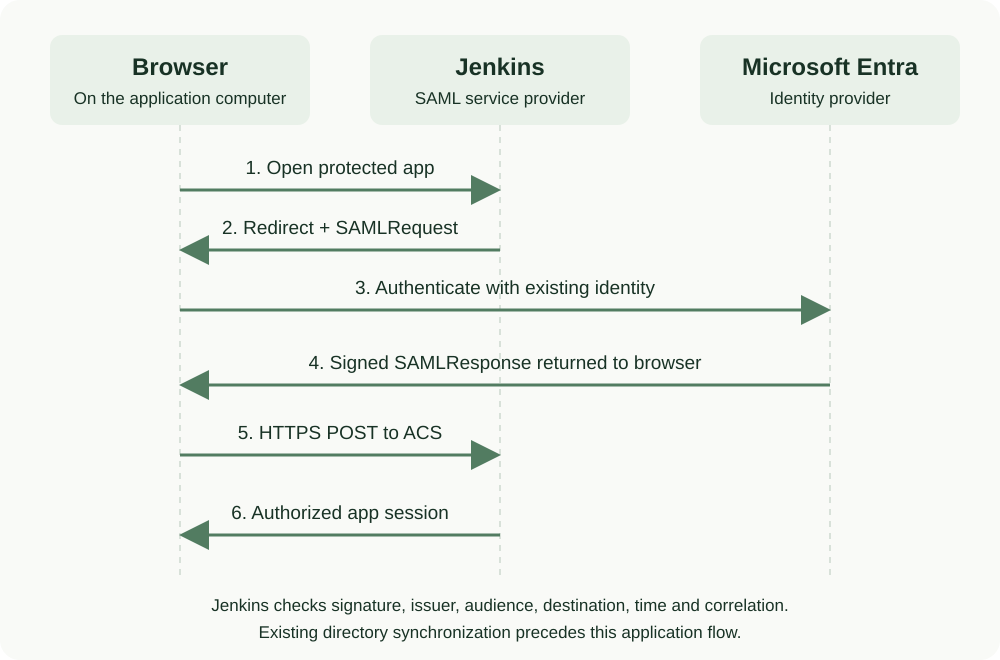
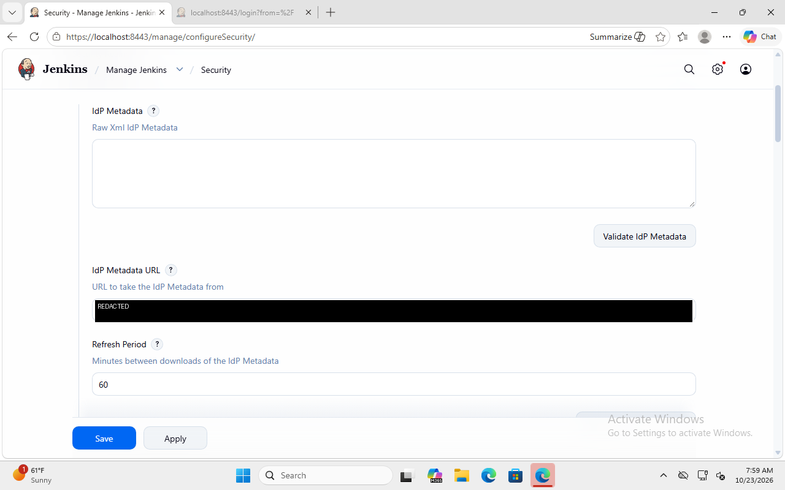
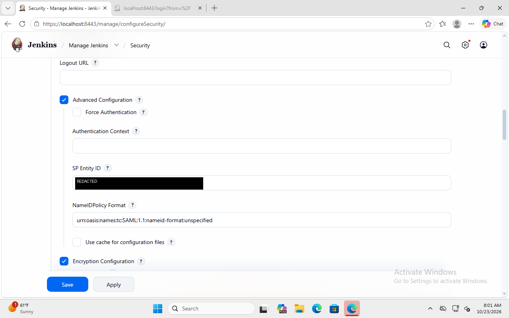
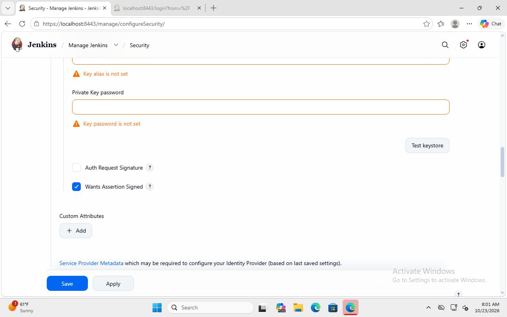
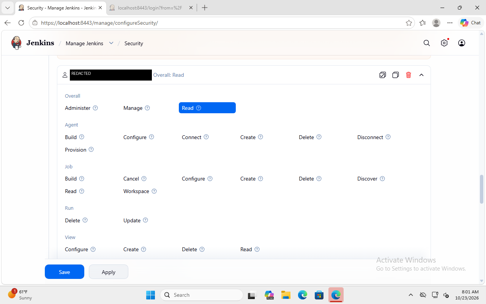
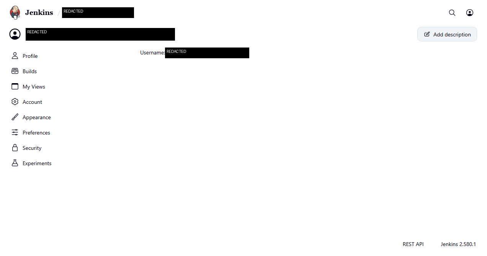
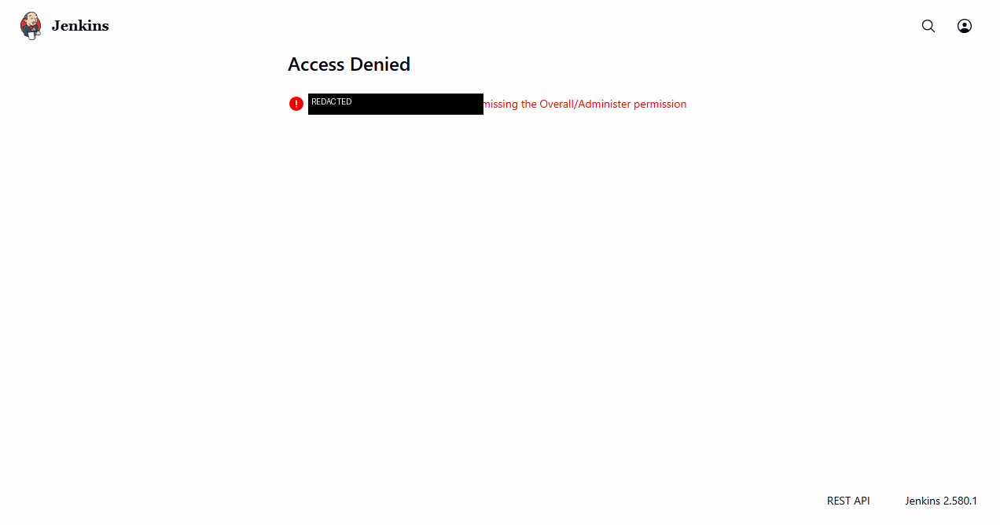
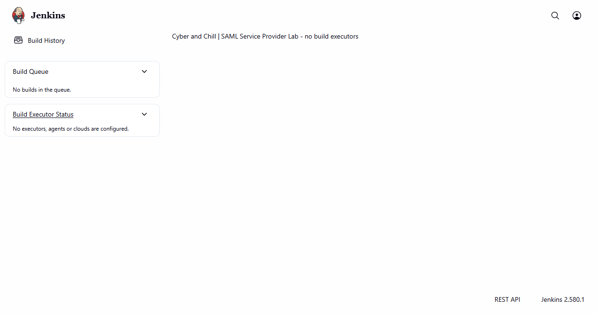

# Manual walkthrough: Jenkins SAML with Microsoft Entra

Build a local Jenkins application that accepts an existing Microsoft Entra identity through SAML 2.0. The ordinary user can read Jenkins but cannot administer it. The demonstrated identity was synchronized from Active Directory; the application's Windows host was already hybrid joined.

**Recorded result, October 23, 2026:** real browser sign-in succeeded, the signed assertion passed cryptographic and protocol checks, and the ordinary user's administration request returned **403**. A new SAML login also succeeded after restarting Jenkins. This page teaches the equivalent conventional procedure; it does not claim a fresh manual replay.

## Starting environment, permissions and software

Start with a Windows 11 Pro training computer, a browser and outbound HTTPS access. For the demonstrated hybrid variant, first complete the [Active Directory project](../day-01/GUIDE.md) and [hybrid identity project](../day-02/GUIDE.md). Their prerequisites include an AD domain, DNS, synchronized ordinary user and healthy hybrid-joined client. Those tutorials supply the preceding build; this project does not repeat domain-controller installation.

SAML itself does not require the application host to join AD or Entra. An existing cloud-only Entra user can reproduce application federation, but that alternative does not reproduce the synchronized-user starting state demonstrated here.

| Component | Recorded version / requirement |
|---|---|
| Application host | Windows 11 Pro; 4 GiB training computer; browser and application on the same computer |
| Jenkins | LTS 2.580.1, standalone WAR distribution |
| Java | Microsoft OpenJDK 21.0.12.1+1; use a Jenkins-supported, maintained Java 21 or 25 distribution |
| SAML plugin | `saml` 4.623.v7875d61cd9f5; fixes earlier replay and access-control advisories |
| Authorization plugin | Matrix Authorization Strategy (`matrix-auth`) 3.3, plus mandatory dependencies |
| Network | HTTPS `https://localhost:8443/`; listener bound to `127.0.0.1`; plain HTTP disabled |
| Workload | Authentication demonstration; zero build executors; no inbound build agents |
| Local permissions | Administrator for initial folder permissions if needed; run Jenkins under an unprivileged account |
| Entra administration | Application Administrator or Cloud Application Administrator with permission to configure the enterprise application and assign users |
| Ordinary identity | Enabled synchronized standard user; no directory administrator role needed |

Jenkins and its SAML integration are open source. Use a valid Windows license or evaluation under its terms and an existing Entra tenant. Basic SSO/direct user assignment is the intended scope; group assignment, Conditional Access and other premium features can have additional licensing requirements. No Azure compute, paid Jenkins add-on or application API permission is required by the demonstrated SAML login. Check your tenant's [current licensing](https://learn.microsoft.com/en-us/entra/fundamentals/licensing) and [assignment requirements](https://learn.microsoft.com/en-us/entra/identity/enterprise-apps/assign-user-or-group-access-portal).

Tested versions are a historical record, not a recommendation to ignore future updates. Recheck [Jenkins Java support](https://www.jenkins.io/doc/book/platform-information/support-policy-java/) and [SAML plugin advisories](https://plugins.jenkins.io/saml/) before installing.

## Architecture and expected result



This is an explanatory diagram, not a screenshot. The browser opens Jenkins, follows its SAML authentication request to Entra, and carries the signed response back to Jenkins' Assertion Consumer Service (ACS). Jenkins validates it and creates a separate application session. Existing AD-to-Entra synchronization supplies the identity before this flow; Windows domain join is not the SAML exchange.

The browser and Jenkins run on the **same computer**. `localhost` always means the computer running that browser. The cloud does not need an inbound network route to the local service: the browser delivers the response. This local design is unsuitable for other computers' browsers without a separate DNS, HTTPS and network design.

Use these values consistently. Values containing `YOUR-VERIFIED-DOMAIN` are placeholders: substitute a domain verified in your own tenant, not the literal example.

| Setting | Value |
|---|---|
| Enterprise application name | `Jenkins SAML Lab` |
| Jenkins root URL / sign-on URL | `https://localhost:8443/` |
| Reply URL / ACS | `https://localhost:8443/securityRealm/finishLogin` |
| Entra Identifier and Jenkins SP Entity ID | `https://YOUR-VERIFIED-DOMAIN/jenkins-saml-lab` |
| Username claim | `http://schemas.xmlsoap.org/ws/2005/05/identity/claims/name` |
| Example ordinary account | `learner@YOUR-VERIFIED-DOMAIN` |
| Example separate application administrator | `app-admin@YOUR-VERIFIED-DOMAIN` |
| NameIDPolicy Format | `urn:oasis:names:tc:SAML:1.1:nameid-format:unspecified` |

The administrator and learner examples represent different accounts. Use their actual Entra principal names, normalized to lowercase, in Jenkins' permission entries.

## 1. Check the existing identity and workstation

**GUI navigation:** Windows **Settings → Accounts → Access work or school** and **Settings → System → About → Domain or workgroup**. In Entra, use **Entra ID → Users → All users → select the learner → Properties**. Older portal navigation calls Entra ID **Identity**.

**Click and configure:** Inspect the existing connection and the intended user's account status and on-premises synchronization information. For the hybrid route, sign into Windows as the ordinary domain user. Do not create a second cloud-only user with a similar name. If an initial password change or MFA registration is required, complete it privately before testing this application.

**Expected result and verification:** The intended enabled user exists in the intended tenant; the synchronized-user route shows synchronization enabled. Windows shows the intended existing domain/work connection. Deeper device verification can use `dsregcmd /status`: check only the relevant join flags; never publish its full output.

**Troubleshooting:** Fix DNS, clock, disabled-account or synchronization problems first. A machine's hybrid join does not grant access to an enterprise application. A cloud-only account can test SAML but is a different starting case.

## 2. Prepare the application folder and Java

**GUI navigation:** **File Explorer → This PC → Local Disk (C:) → New → Folder**; then **folder → Properties → Security → Advanced**.

**Click and configure:** Create `C:\SamlLab`. Give the intended unprivileged application user Modify access and administrators Full control; avoid granting all users write access. Create `java` and `home` subfolders. Download the Windows x64 ZIP from the [official Microsoft OpenJDK page](https://learn.microsoft.com/en-us/java/openjdk/download), plus its SHA-256 file. Right-click the ZIP → **Extract All** into `C:\SamlLab\java`. Download the [official Jenkins WAR](https://www.jenkins.io/download/) and its checksum, saving the WAR as `C:\SamlLab\jenkins.war`.

**Command exception:** Windows does not provide a simple standard GUI checksum comparator. In PowerShell, run `Get-FileHash '<downloaded-file>' -Algorithm SHA256` and compare the entire digest with the vendor's checksum for that exact artifact. Repeat for Java and Jenkins. No password belongs in this command.

**Expected result and verification:** File Explorer shows the WAR, extracted Java `bin\java.exe`, and empty `home` folder. Every downloaded binary matches its official checksum.

**Troubleshooting:** An HTML page saved as a ZIP/WAR is not an installer. Do not use a mismatched checksum or an unsupported Java runtime. The standalone WAR has no installation wizard; it is deliberately used here rather than presenting an untested Windows MSI procedure as the recorded installation.

## 3. Create a local HTTPS certificate

**GUI navigation:** **Start → Windows PowerShell** in the application user's session. Local self-signed certificate creation has no simple certificate-manager wizard without an issuing certificate service, so use this conventional command alternative:

```powershell
$cert = New-SelfSignedCertificate -DnsName localhost `
  -CertStoreLocation Cert:\CurrentUser\My -KeyExportPolicy Exportable `
  -KeyLength 3072 -HashAlgorithm SHA256 -NotAfter (Get-Date).AddYears(1)
Export-PfxCertificate -Cert $cert -FilePath C:\SamlLab\https.pfx `
  -Password (Read-Host 'Choose a strong private PFX password without whitespace' -AsSecureString)
Export-Certificate -Cert $cert -FilePath C:\SamlLab\https.cer
```

The private PFX password is only for this local keystore; it is not a Windows or Entra account password. Retain it privately for attended starts. Protect `https.pfx` with the same restricted folder permissions. Never share the PFX.

**Expected result and verification:** Run **certmgr.msc → Personal → Certificates → localhost → Open → Details**. Confirm that Subject Alternative Name includes `localhost`, the certificate is not expired and Server Authentication is permitted.

**Troubleshooting:** A certificate for another name will cause HTTPS errors even if it is trusted. Use a proper CA-issued certificate for a shared deployment. The public `.cer` and private-key-containing `.pfx` have different handling requirements.

## 4. Trust only the local lab certificate

**GUI navigation:** **certmgr.msc → Trusted Root Certification Authorities → Certificates → right-click → All Tasks → Import**.

**Click and configure:** Choose `C:\SamlLab\https.cer`, inspect the certificate you just created, select the Trusted Root store for the current user, and finish. Do this as the same Windows user who will browse Jenkins. Do not import the PFX into the Root store.

**Expected result and verification:** The exact certificate appears in the user's Root store. Compare its thumbprint with the certificate in **Personal**. Browsing the application in the next step should show a trusted HTTPS connection.

**Troubleshooting:** Trusting a different certificate with the same display name is insufficient. Friendly names can be lost during export; compare thumbprints. This per-user trust method is a conventional reproduction choice; the recorded application used a locally trusted localhost certificate, not a public certificate.

## 5. Start Jenkins over loopback HTTPS

**Command exception:** The standalone WAR is launched with Java; there is no equivalent built-in Windows GUI launch wizard. Open a normal, unprivileged PowerShell session and run:

```powershell
$env:JENKINS_HOME = 'C:\SamlLab\home'
$javaExe = (Get-ChildItem C:\SamlLab\java -Filter java.exe -Recurse |
  Select-Object -First 1).FullName
if (-not $javaExe) { throw 'Check the Java extraction folder' }
$secret = Read-Host 'PFX password' -AsSecureString
$pointer = [Runtime.InteropServices.Marshal]::SecureStringToBSTR($secret)
try {
  $plain = [Runtime.InteropServices.Marshal]::PtrToStringBSTR($pointer)
  "--httpPort=-1 --httpsPort=8443 --httpsListenAddress=127.0.0.1 --httpsKeyStore=C:\SamlLab\https.pfx --httpsKeyStorePassword=$plain --sessionTimeout=30" |
    & $javaExe -Xms128m -Xmx768m -jar C:\SamlLab\jenkins.war --paramsFromStdIn
} finally {
  [Runtime.InteropServices.Marshal]::ZeroFreeBSTR($pointer)
  $plain = $null
  $secret.Dispose()
}
```

Keep the terminal open. This supplies the password through standard input, avoiding a literal password in shell history or Java's process command line. Do not enable transcripts or echo its value. No private helper is required. This is an attended manual launch; it does not reproduce the original background startup mechanism.

**GUI navigation and expected result:** Open Edge on this same computer → `https://localhost:8443/`. Wait for **Unlock Jenkins**. Inspect the browser's connection/certificate details; it should trust the expected localhost certificate.

**Verification:** Optionally run `Get-NetTCPConnection -LocalPort 8443 -State Listen`; the address should be `127.0.0.1`. HTTP should not be listening on Jenkins' default port. If Windows asks to expose Java through its firewall, do not add an inbound rule for this loopback-only lab.

**Troubleshooting:** Check terminal errors, extracted Java path, port collision, PFX password, certificate trust and read permissions. A blank or unavailable page is not evidence that SAML is broken. Do not run Jenkins as a domain administrator or disable the firewall to fix startup.

## 6. Finish initial Jenkins setup and install the two plugins

**GUI navigation:** **Unlock Jenkins → Customize Jenkins → Select plugins to install**. For an already initialized installation: **Manage Jenkins → Plugins → Available plugins**.

**Click and configure:** Privately read the initial administrator password from `C:\SamlLab\home\secrets\initialAdminPassword` as directed by Jenkins. Paste it only into the local unlock form. Search for and install **SAML** (`saml`) and **Matrix Authorization Strategy** (`matrix-auth`), including required dependencies. Complete **Create First Admin User** and retain that temporary bootstrap account privately. Restart Jenkins if requested, using the same home directory and launch parameters.

**Expected result and verification:** The dashboard loads. In **Manage Jenkins → Plugins → Installed plugins**, confirm both plugins and their versions. The tested SAML plugin is 4.623.v7875d61cd9f5; do not select a release affected by its published replay/access-control issues.

**Troubleshooting:** Plugin dependency or minimum-core-version errors require compatible versions, not disabling security. The normal unlock/setup sequence is the conventional fresh-install path; these exact fresh-install clicks were not independently replayed for publication.

## 7. Set Jenkins' canonical URL and limit the workload

**GUI navigation:** **Manage Jenkins → System → Jenkins Location**; **Manage Jenkins → Nodes → Built-In Node → Configure**; **Manage Jenkins → Security → Agents**.

**Click and configure:** Set **Jenkins URL** to `https://localhost:8443/` and save. Set the built-in node's **Number of executors** to `0` and save. Set **TCP port for inbound agents** to **Disable**.

**Expected result and verification:** Reopen System and confirm the URL. The dashboard's executor panel should report that no executors/agents are configured. This lab demonstrates authentication rather than a build pipeline.

**Troubleshooting:** The Jenkins URL determines generated SAML endpoints. A wrong scheme, port, path or trailing slash can produce a callback mismatch even when the browser can load the dashboard.

## 8. Create the non-gallery Entra application

**GUI navigation:** **Microsoft Entra admin center → Entra ID → Enterprise apps → All applications → New application → Create your own application**. Some layouts use **Identity → Applications → Enterprise applications**.

**Click and configure:** Sign in privately as the application administrator. Enter `Jenkins SAML Lab`; select **Integrate any other application you don't find in the gallery (Non-gallery)** → **Create**. Open it → **Single sign-on → SAML**.

**Expected result and verification:** A SAML setup page appears with Basic SAML Configuration, Attributes & Claims, SAML Signing Certificate and setup/test sections. Confirm that you are editing the newly created application's enterprise application, not an unrelated app registration.

**Troubleshooting:** Greyed-out SAML or denied creation can indicate an unsuitable application type, role or tenant policy. Do not create repeated duplicate apps. **Procedure status:** this portal path is derived from official documentation; the recorded application was configured programmatically and this exact portal sequence was not replayed.

## 9. Enter the identifier, Reply URL and sign-on URL

**GUI navigation:** **Enterprise application → Single sign-on → SAML → Basic SAML Configuration → Edit**.

**Click and configure:** Enter the three corresponding values from the table above: your verified-domain **Identifier (Entity ID)**, exact localhost **Reply URL (ACS)**, and localhost **Sign on URL**. Save. Remove unrelated/default Reply URLs rather than relying on ambiguous selection.

**Expected result and verification:** Reopen Edit and compare each value character for character. The Reply URL ends in `/securityRealm/finishLogin`; the Entity ID is a logical identifier and need not host a reachable website. It must match Jenkins' SP Entity ID.

**Troubleshooting:** `AADSTS50011` commonly means the Reply URL differs. Check HTTPS, `8443`, case-sensitive `finishLogin`, path and trailing slash. An identifier mismatch can prevent app discovery or fail audience validation. Do not change public DNS for this localhost design.

## 10. Confirm claims and the signing certificate; assign both users

**GUI navigation:** **Single sign-on → Attributes & Claims → Edit**; **SAML Signing Certificate**; **Properties**; **Users and groups → Add user/group**.

**Click and configure:** Confirm that the signed claim `http://schemas.xmlsoap.org/ws/2005/05/identity/claims/name` maps to `user.userprincipalname`. Inspect the Unique User Identifier/Name ID mapping rather than assuming its value. Confirm an active signing certificate; if none exists, create one through **SAML Signing Certificate → Edit → New certificate → Save**, then make it active. Retain the default supported SHA-256 signing configuration. Copy the app-specific **App Federation Metadata Url**.

In **Properties**, set **Assignment required? → Yes → Save**. Under **Users and groups**, select the ordinary user → **Select → Assign**, using the app's available default/User role. Repeat for the separate application administrator. Their Entra application assignment does not itself grant Jenkins administration.

**Expected result and verification:** The certificate is active and unexpired; both accounts appear in the assignment list. No Graph application permission or client secret is needed by Jenkins to consume SAML metadata and assertions. The ordinary account retains its existing directory privileges.

**Troubleshooting:** Missing assignment can cause `AADSTS50105`. Select the role the application actually exposes; do not invent a role. A missing mail property does not mean the UPN/name claim is absent. An opaque NameID is valid: the recorded flow used the separate signed `name` claim for its Jenkins username.

## 11. Configure Jenkins' SAML realm

**GUI navigation:** **Manage Jenkins → Security → Security Realm → SAML 2.0**. Older versions call this **Configure Global Security**.

**Click and configure:** Set **IdP Metadata URL** to your app's metadata URL and **Refresh Period** to `60` minutes. Leave **Raw XML IdP Metadata** empty when using the URL. Set **Username Attribute** to the name-claim URI above; set **Username Case Conversion → Lowercase**. Use **Data Binding Method → HTTP-Redirect**. Leave unneeded email/group mappings empty; a display name can use the same name claim for this lab.



*Authentic configuration screen: the metadata URL supplies the IdP trust information and the refresh interval is 60 minutes. The hidden value must come from your own application. This capture precedes Save and alone is not proof of a completed sign-in.*

Enable **Advanced Configuration**. Enter the exact matching **SP Entity ID** and the **NameIDPolicy Format** from the values table. Leave **Force Authentication** off so a valid existing Entra session can be reused.



*The SP identifier must match the Entra Identifier. The selected NameID policy is unspecified; it does not force NameID to equal the user's UPN.*

Enable **Encryption Configuration** to expose **Wants Assertion Signed**, and check that option. Assertion signing and assertion encryption are distinct features. This lab did not configure encrypted assertions or a custom SP keystore; the plugin can generate its own SP key.



*The signed-assertion requirement is checked. Empty optional custom-keystore fields produced warnings in this screen; they are not the source of the IdP verification key. Actual successful signature verification is supported by the recorded flow results, not inferred from a checkbox.*

**Expected result and verification:** Fields match your Entra application. The plugin's **Service Provider Metadata** link, once the saved configuration is active, should expose the intended Entity ID and ACS. Do not save until the authorization entries in the next step are prepared.

**Troubleshooting:** Check metadata URL accessibility, certificate expiry, clock accuracy and exact claim URI spelling. Do not disable signature checks to make a login succeed. Entra's signed NameID may be opaque; configure the actual signed username claim intentionally.

## 12. Set the permission matrix and save the realm switch

**GUI navigation:** On the same **Security** page → **Authorization → Matrix-based security → Add user**.

**Click and configure:** Add the lowercase ordinary UPN → **OK** → grant only **Overall → Read**. Add the separate application administrator's lowercase UPN and grant **Overall → Administer**. Leave **Anonymous** and **Authenticated Users** without broad grants. Remove the bootstrap account's administration grant after confirming that the assigned Entra administrator and matrix entry match. Select **Save**.



*The ordinary user has Read, with Administer unselected. Its name is redacted. A new federated name can initially look unknown to the local bootstrap realm; this does not require another local password account.*

**Expected result and verification:** A new Jenkins login now uses Entra. The saved permissions distinguish application authentication from application administration. The old local bootstrap password is not a fallback under the SAML realm.

**Troubleshooting:** Username case and claim mismatch can lock out an administrator. Before switching, securely retain a known-good configuration locally. Recovery requires stopping the local application and restoring that known-good configuration; never expose an unsecured Jenkins listener. The separate administrator's browser login was configured but not exercised in the recorded validation.

## 13. Perform the real ordinary-user SAML sign-in

**GUI navigation:** On the application computer, browse to **https://localhost:8443/** → **Sign in** when needed.

**Click and configure:** Select or enter the intended ordinary Entra account. Complete provider-required password/MFA privately. Do not disable MFA or Conditional Access. Existing Windows/Entra authentication may satisfy sign-in without a new prompt, but that depends on browser/session state and tenant policy.

**Expected result and verification:** The browser returns to Jenkins' dashboard. Open the profile icon → **Profile**, or browse to `https://localhost:8443/me/`, and confirm the intended username.



*A genuine Jenkins user profile after the application accepted the SAML flow. Identity text is masked rather than replaced with a fictional account. The separate measured identity check confirmed the intended ordinary user.*

**Troubleshooting:** An access-denied page after a successful redirect can be a Jenkins permission/claim issue rather than an Entra authentication failure. Investigate the effective username and matrix entry. Browser and application sessions have separate lifetimes; no permanent prompt-free sign-in is promised.

## 14. Verify least privilege and distinguish negative tests

**GUI navigation:** As the ordinary user, browse to **https://localhost:8443/manage/configureSecurity/**.

**Click and configure:** Confirm that administration is denied; return to the dashboard. In a fresh InPrivate window, try a protected application page and observe either authentication redirection or denial. A browser with an existing Entra session may sign in again automatically, so InPrivate behavior is not a substitute for an independent anonymous HTTP check.



*The live application denies Overall/Administer to the ordinary user. The recorded HTTP status was 403. This is a successful authorization control, not a failed SAML login.*

**Expected result and verification:** The user can read the dashboard but cannot change global security. Optional deeper checks can request `/whoAmI/api/json` privately and inspect the expected username and `anonymous` flag. Jenkins can report `authenticated: true` for an anonymous security token, so do not rely on that field alone.

**Troubleshooting:** If the ordinary user can administer, remove broad authenticated-user grants or its accidental Administer permission. Do not infer replay resistance from the recorded synthetic unsigned, unsolicited-response rejection: correlation checks may also explain that rejection. A real unassigned-user login, replay and certificate-rollover tests were not performed.

## 15. Restart Jenkins and repeat the login

**GUI navigation:** Use the terminal running the attended WAR process. Stop only that application with **Ctrl+C**. Repeat the launch sequence from step 5 with the same home, PFX, URL and plugins, then browse to Jenkins again.

**Click and configure:** Repeat the ordinary-user SAML login and the administration-denial check. If your own deployment uses a separately configured startup service, inspect its limited identity and settings in its supported management interface. This guide's attended launch deliberately does not require that optional service configuration.



*The application remained configured after restart; the new SAML flow and ordinary-user authorization passed. Zero executors/agents are visible. This is a service-restart result, not a Windows or host reboot test.*

**Expected result and verification:** Existing SAML settings persist and the ordinary identity still has read-only access. This was observed in the recorded build.

**Troubleshooting:** A different `JENKINS_HOME` can look like a new installation. Expired certificates, changed app assignments or revoked sessions can require repair or fresh authentication. Monitor TLS and IdP signing-certificate expiry; automatic rollover and reboot behavior remain untested here.

## Evidence boundaries and procedure status

| Area | What was actually tested |
|---|---|
| Jenkins realm and permission GUI | Actual automated interaction with these GUI controls, saved-state inspection and authentic screenshots |
| Entra application | Working configuration and assignments inspected; equivalent portal instructions derived, not manually replayed |
| Fresh Java/certificate/bootstrap command sequence above | Conventional reproduction path; example sequence not independently replayed |
| Real browser SAML | Signed assertion, issuer, audience, destination, time, correlation and mapped ordinary-user claim checked |
| Application authorization | Ordinary-user administration 403; separate anonymous protected API 403 |
| Synthetic negative response | Unsigned, unsolicited response did not authenticate; does not isolate individual validator behavior |
| Persistence | Jenkins restart and subsequent ordinary-user SAML login passed |
| Not tested | Separate administrator browser login, real unassigned-user login, replay, rollover, MFA-policy changes, federated logout, Windows/host reboot, full fresh-environment manual replay |

Screenshots were captured on October 23, 2026. Privacy processing used conspicuous masks and lossless PNG copies; no UI or result values were fabricated. No Entra portal screenshot or human manual execution is claimed.

## Primary references

- [Jenkins WAR installation and initial setup](https://www.jenkins.io/doc/book/installing/war-file/)
- [Jenkins HTTPS and stdin parameters](https://www.jenkins.io/doc/book/installing/initial-settings/)
- [Jenkins SAML configuration](https://github.com/jenkinsci/saml-plugin/blob/main/doc/CONFIGURE.md)
- [Entra SAML setup](https://learn.microsoft.com/en-us/entra/identity/enterprise-apps/add-application-portal-setup-sso)
- [Assign users to an enterprise application](https://learn.microsoft.com/en-us/entra/identity/enterprise-apps/assign-user-or-group-access-portal)

[Project overview and supporting build history](README.md) · [Portfolio](../../README.md)
