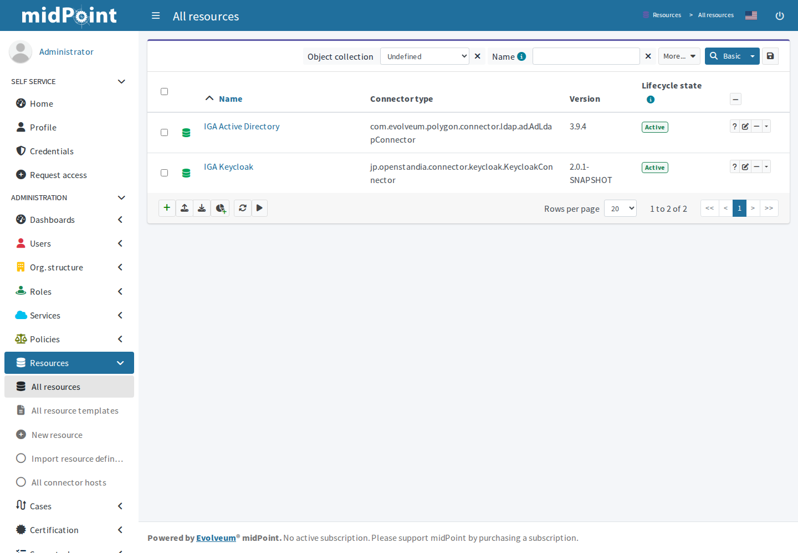
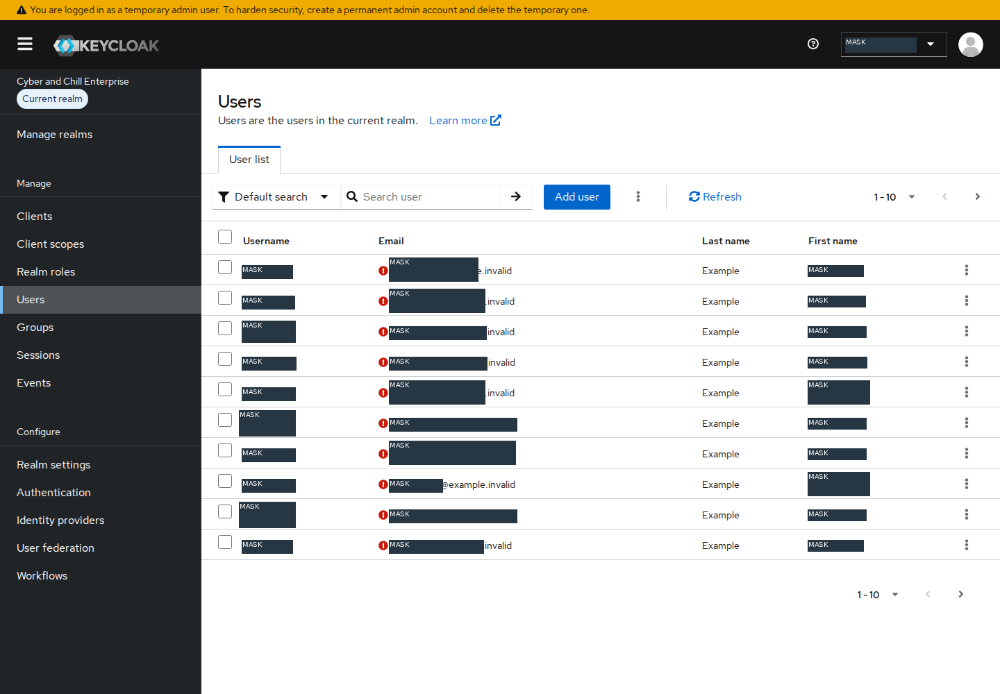
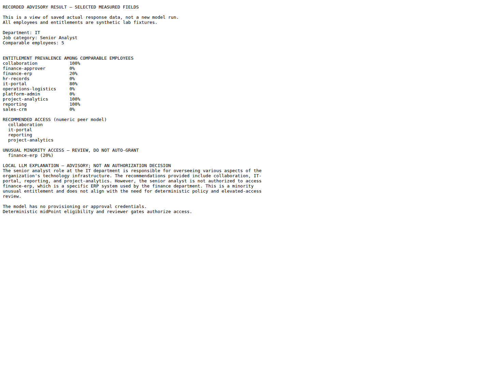
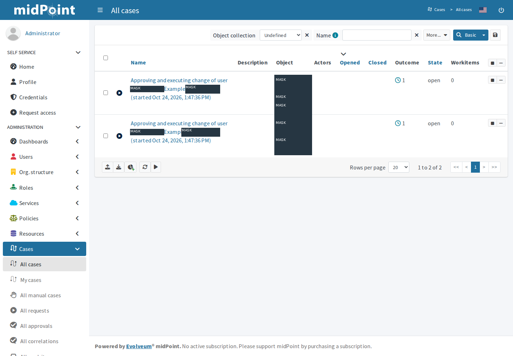
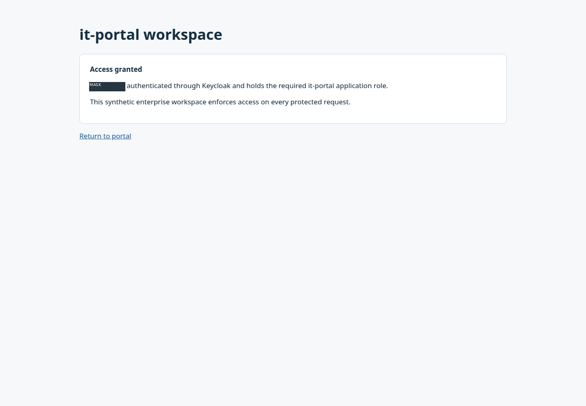
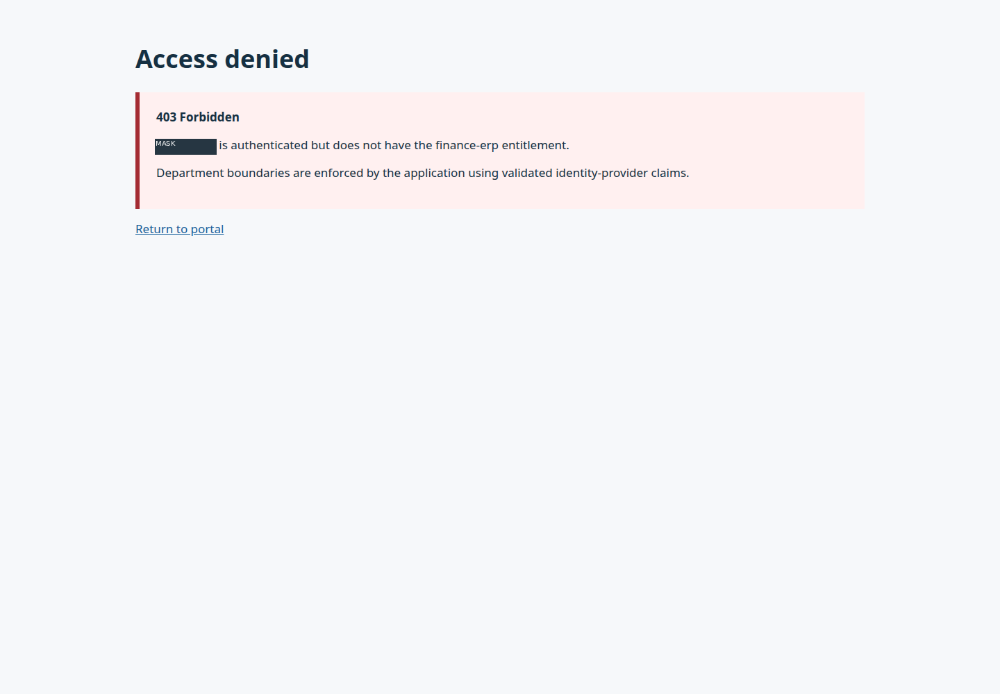
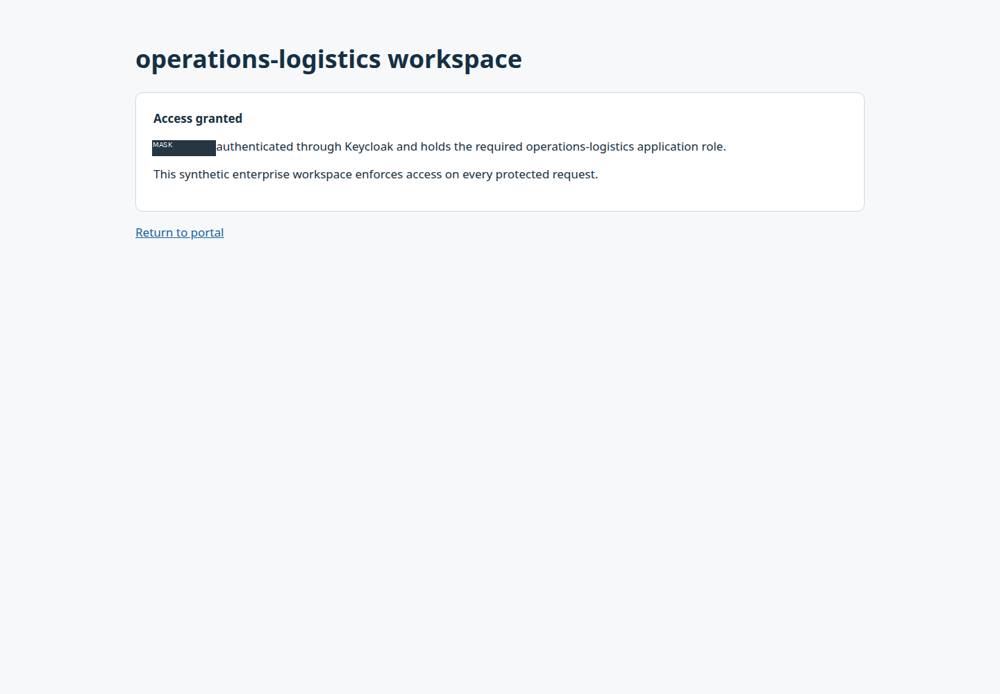

# AI-Assisted Employee Onboarding — Conventional Setup Guide

**Goal:** Receive synthetic HR records, recommend access from peer entitlements, enforce midPoint policy and approvals, provision real AD/Keycloak accounts, and test application authentication and authorization.

**Status:** Conventional reproduction instructions derived from the completed implementation. Native application sign-in, midPoint navigation and case views were exercised through automated browser interactions. Configuration was performed through supported APIs and conventional tooling. Equivalent configuration clicks below are derived from the resulting configuration and vendor documentation; a fresh full manual replay was not performed. Do not rerun setup on the retained working lab merely to inspect it.

## Prerequisites

- An existing isolated AD domain with working DNS, a trusted LDAPS server certificate, and an administrator who can delegate control of a dedicated training OU. Preserve prior users and synchronization scope.
- A designated Linux application server with Docker/Compose, outbound package/model access, approximately 12 GiB RAM and sufficient disk space. The recorded application guest had 32 GiB disk capacity; check physical free space during image downloads.
- midPoint 4.10.5 with its native PostgreSQL repository; PostgreSQL 16; Keycloak 26.6.1; the pinned community Keycloak connector identified in [the version receipt](evidence/versions.json); Python 3.14 with scikit-learn 1.7.2; Ollama and `qwen2.5:0.5b`.
- Separate midPoint setup administrator, HR requester and access reviewer identities. Use unique service credentials; never give the recommendation service those credentials.
- Use the conventional integration recipe and example REST requests in the [extended reference](REFERENCE.md). The original environment-specific integration is not distributed; an independent adapter and protected application must implement that contract. This is not a turnkey software package.
- Example values below use reserved documentation names such as `ad.lab.example.com` and `example.invalid`. Substitute your own lab values. Do not use the example namespace as a real routable service.

## Step 1 — Start the identity services

1. On the designated application server, inspect existing containers and persistent volumes before creating anything.
2. Follow the [official midPoint container deployment](https://docs.evolveum.com/midpoint/get-started/install/containers/) using the native PostgreSQL repository. Pin the image to `evolveum/midpoint:4.10.5-alpine`; initialize repository/audit schemas once and preserve the midPoint home and database volumes.
3. Set a unique initial administrator password through `MP_SET_midpoint_administrator_initialPassword` before first startup. A later change to that setting does not reset an existing account. If already installed, use the existing valid administrator session.
4. Start Keycloak with persistent storage. For this isolated lab, the recorded server used its development startup mode. Set the canonical URL to the URL that the browser will actually use.
5. Download the recorded Keycloak connector artifact, or build the exact source revision in [the version receipt](evidence/versions.json). Place the JAR in `midpoint.home/icf-connectors` and restart only midPoint to load it.
6. In the browser, sign in to midPoint. Open **Configuration → Repository objects**, select **Connector**, and confirm the AD LDAP and Keycloak connector types exist.

*Authentic midPoint browser capture from the configured system, October 24, 2026. It identifies the working service and loaded connectors, not a manual installation replay.*

**Expected result and verification:** Both services open successfully, the midPoint native repository is initialized, and the required connector types appear. Preserve the encryption keystore with the database; do not recreate volumes to recover a sign-in problem.

## Step 2 — Prepare the directory and application catalog

1. Open **Server Manager → Tools → Active Directory Users and Computers**. In the existing training root, create a separate **IGA** OU, then **Employees**, **Groups**, and **ServiceAccounts** beneath it. Keep this outside any existing cloud synchronization OU scope.
2. Create an ordinary connector service account in **ServiceAccounts**. Right-click **Employees → Delegate Control**, select that account, and delegate only the required user management/reset/read operations. Repeat on **Groups** for owned group management and membership changes. Do not add the account to Domain Admins.
3. Under **Groups**, create the ten application entitlement groups listed in the reference. They are application access groups; the `platform-admin` application role does not grant AD domain administration.
4. Verify the AD DNS name matches the LDAPS certificate. Trust only the intended public certificate in midPoint's existing keystore; retain the existing encryption keys.
5. In the **Keycloak Admin Console**, create a dedicated realm. Open **Realm roles → Create role** for each entitlement, then **Groups → Create group** for the matching groups. Open each group → **Role mapping → Assign role** and associate its realm role.
6. Open **Clients → Create client** and create a confidential service-account client for midPoint. Disable interactive/direct-password flows for that client, enable service accounts, and grant only the realm-management permissions needed for user/group provisioning in this realm.

*Authentic native inventory after provisioning; synthetic identity labels are masked. Account existence is also checked directly in AD and Keycloak.*

**Expected result and verification:** The owned containers/groups exist, the connector account has no directory administration group membership, and the dedicated Keycloak realm has its groups and application roles. A trusted LDAPS connection succeeds; a bare open TCP port is insufficient evidence of TLS.

## Step 3 — Connect AD and Keycloak to midPoint

1. In midPoint, open **Resources → New resource** and choose the AD LDAP connector. Enter the LDAPS host, port `636`, TLS connection security, delegated bind identity, protected credential and dedicated IGA base context.
2. In the resource wizard/schema handling, define **account/default** for AD `user` and **entitlement/group** for AD `group`. Map login name, DN, given/family name, display name, UPN, department, job title and employee identifier. Add activation and password outbound mappings.
3. Enable current connector native group references using `managedAssociationPairs = "user"+memberOf -# "group"+member`. Refresh the cached resource schema. Define a resource-level association type from **account/default** through `ri:group` to **entitlement/group**.
4. Add an outbound `associationConstruction → objectRef → mapping → associationFromLink` mapping. Set association tolerance to **false** for the scoped synthetic groups. Link the existing owned group projections to their entitlement roles.
5. Create the Keycloak resource with the community connector. Enter the canonical server URL, authentication/target realm, confidential client ID and protected client secret. Define `user` and `group` object types; map `username`, names, email, activation and password.
6. Configure Keycloak `groups` as **explicitly fetched** and **not tolerant** of extra values. Entitlement roles supply the group IDs; group-to-realm-role mappings supply the actual application roles.
7. Run each resource's **Test connection** action. Open one employee's projections and verify the actual target accounts and memberships, not just two shadow links.

*Authentic native resource view. The final connection results and direct target membership checks are retained separately.*

**Expected result and verification:** Both resource tests report success and a test identity receives the intended memberships in both targets. Removing an entitlement must remove it from both targets. Older association syntax and an unfetched Keycloak group attribute produced failures in the original implementation; see troubleshooting.

## Step 4 — Load the enterprise and prepare advisory recommendations

1. Freeze the business-owner expected-access matrix before fitting the recommender. Keep it outside model features and retain its hash. Use the entitlement/job matrix in the reference.
2. Prepare 100 synthetic existing employees: five departments, four job categories, five peers per department/job combination. Include recorded legacy overgrants and missing memberships. Keep these fixtures separate from the 20 hire records.
3. Seed the historical identities through midPoint and reconcile them. Compare the source fixture against actual AD and Keycloak memberships before treating it as model input.
4. Install the small existing Ollama model using the conventional CLI: `ollama pull qwen2.5:0.5b`. Keep the model service local.
5. In Python, encode department, job category and access level with scikit-learn `DictVectorizer`; fit `NearestNeighbors` with cosine distance and `k=5`. Recommend entitlements present in at least 60% of comparable peers. The reference gives the feature calculation, event contract and conventional REST request shapes.
6. Send only the recommendation scores and unusual patterns to Ollama's `/api/generate` endpoint for an explanation. Treat that prose as advisory. Do not turn LLM text into grants or approval decisions.
7. Run the advisory service under a separate OS identity that cannot read the midPoint/AD/Keycloak or reviewer credentials. Keep the expected-access file out of its training inputs.

*A genuine browser capture of a clearly labeled view of saved actual response fields. This is a measured-data visual, not a fresh model run or a screenshot of a recommendation application.*

**Expected result and verification:** All 20 hire records produce real recommendation scores, peer IDs and local LLM explanations. In the recorded synthetic fixture, in-sample analysis flagged 25 unusual existing entitlements and 20 missing majority entitlements. It did not revoke historical access. The small LLM sometimes produces generic or truncated explanations; the numeric results and native policies remain authoritative.

## Step 5 — Enforce eligibility and reviewer approval

1. In **Roles → All roles**, define a base account role and the ten requestable access roles. The base role creates AD/Keycloak accounts without application privileges. Entitlement roles induce only their target groups.
2. Add deterministic eligibility rules: departmental application access requires the matching department; reporting requires Senior Analyst/Manager; project analytics requires Analyst/Senior Analyst; elevated Finance/IT access additionally requires the matching department and Manager title.
3. Through **Configuration → Repository objects → System configuration**, add the explicit assignment-level approval rule from the reference, scoped to the two elevated role IDs and the synthetic new-hire population. Set `evaluationTarget` to `assignment` and reject if no approver exists.
4. Configure the HR requester with request-phase assignment authorization for an **exact allowlist of the eleven base/access role IDs**. Give assignment modification only in execution phase, and permit only the required execution operations on the two owned resource shadows. Do not authorize raw operations, reviewer roles or superuser roles.
5. Create a distinct access reviewer with case read/completion authority. For the conventional GUI path, configure the built-in **Approver** role and appropriate self-service UI access; the recorded decision tests used the REST interface. The advisory service has no reviewer credential. Keep the role catalog separate from administrative role names; a broad name prefix is not an adequate allowlist.
6. Request elevated access. Open **Cases → All cases / All approvals**, inspect the employee, proposed role and reviewer, and confirm the role is still absent from both targets before deciding.

*Authentic pending cases. This image precedes the recorded decisions; identity labels are masked.*

**Expected result and verification:** The HR requester receives 403 if it tries to complete the work item. The distinct reviewer can approve or reject. Browser access remains denied before approval and after rejection, and becomes available after approval. The recorded decisions were automated tests of separate identities, not human review sessions.

## Step 6 — Onboard employees and configure the protected app

1. Use the synthetic HR source to submit the 20 hire records through the authenticated HR endpoint. Each record must contain the employee ID, matching username, given/family name, department, job category and valid access level. Reject unknown fields and invalid categories before provisioning.
2. The integration first creates/locates the midPoint identity, then obtains advisory recommendations and requests only catalog entitlements. midPoint applies eligibility, approval and provisioning. Verify actual memberships before marking an onboarding request complete.
3. In Keycloak, open **Clients → Create client**, create an OIDC public application client, enable the standard authorization-code flow, require **PKCE S256**, disable direct password grants, and set the exact application callback URL. For a local example, use `http://127.0.0.1:18082/callback`.
4. Add an ID-token realm-role mapper for `realm_access.roles`. The application must validate signature, issuer, audience, expiry and nonce; check OAuth state; and enforce the required role on every protected route.
5. Open the application → **Sign in with your employee account**. Authenticate using a provisioned standard employee, then open the matching department workspace and another department's workspace.

*Authentic users in the dedicated enterprise realm; identity fields are masked. The separate master-realm setup view is not used as employee evidence.*

**Expected result and verification:** The correct department workspace returns 200 and the other department returns 403 for the same authenticated identity. The recorded lab repeated browser sign-in and both checks for every one of the 20 hires, and authenticated all 20 directly to AD over verified LDAPS.

## Step 7 — Exercise recovery, replay and the comparison

1. Submit an identical HR record again. Confirm it returns a duplicate result and preserves the same target identities/memberships. Submit a conflicting duplicate and confirm rejection rather than an overwrite.
2. Submit invalid department/title/access-level records and an unexpected entitlement field. Confirm 422 and no created identity. Attempt cross-department, non-manager elevated, reviewer, superuser and raw-operation bypasses using the requester; confirm actual denials.
3. For a separately tracked valid hire, temporarily stop only the lab's Keycloak service. Submit the HR record, record the 503 and the existing midPoint/AD identity, then restore Keycloak. Reconcile the existing identity before replaying the request; do not manually create a second target account.
4. Verify both real targets and sign in to the recovered employee's protected application.
5. Compare the same frozen hire specification against coarse department recommendations and peer recommendations. Count every entitlement decision, including false positives/negatives, and distinguish recommendations from effective grants.
6. Record timing boundaries and review actions honestly. The original conventional comparison used 20 separately tracked temporary identities and verified their deletion. Do not infer a human-time saving from automated review tests.

*Authentic final application access for the hire used in the live outage/recovery scenario.*

## Verification

| Check | Recorded result |
|---|---|
| Historical employees, real target memberships | 100 verified in AD and Keycloak |
| Valid hires with exact independently expected access | 20/20 |
| AD authentication / browser application sign-in | 20/20 each |
| Allowed / cross-department requests | 20 HTTP 200 / 20 HTTP 403 |
| Identical onboarding replays | 20 preserved identities and memberships |
| Negative input/authorization checks | 17 passed |
| Approval gate | Pending denial, requester 403, reviewer approval/rejection, browser outcomes verified |
| Live partial provisioning failure | Keycloak outage → 503 → native recovery; completed |
| Raw recommendation accuracy | Coarse RBAC 89%; peer recommendations 100% on this fixture |
| Excessive recommendations / final excessive grants | Baseline 10 / 0; AI 0 / 0 |

Use the [extended reference](REFERENCE.md) for the access matrix, input contract, current configuration, recovery details, timing limits and evidence locations. Full conventional manual replay and production hardening remain untested; the functional automated acceptance is complete.
