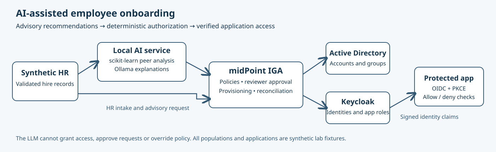

# AI-Assisted Employee Onboarding

**✓ Verified** · [CyberAndChill Portfolio](../../README.md)

## What I built

Integrated midPoint, Active Directory and Keycloak with local peer-based access recommendations and Ollama explanations; native policy and approvals control every grant.

## Why it matters

Reduce incorrect onboarding recommendations while preserving deterministic least-privilege enforcement and independent approval.

## Architecture

## Rebuild it yourself

[**Follow the manual GUI walkthrough →**](GUIDE.md)

The guide gives numbered GUI clicks, settings, useful original screenshots and expected results. An extended technical reference is available when needed.

## Result

All 20 hires were provisioned and passed AD authentication, browser sign-in, allowed department access and denied cross-department access. Approval/rejection, duplicate replay and live partial-failure recovery passed. On this controlled fixture, recommendation accuracy increased from 89% to 100%; both policy-enforced paths had zero excessive grants.

**Technologies demonstrated:** midPoint, Active Directory, Keycloak, Ollama, Python, scikit-learn, OIDC

Technical evidence, validation and troubleshooting

**Checks:** 10/10 passed in the recorded implementation. Original evidence is historical, not a new health check.

**Evidence:** A selection of original screenshots is included in the manual walkthrough.

**Limitations:** Controlled synthetic workload; AI added latency. Human review-time savings, broader generalization and a complete fresh manual replay were not established. The original integration is not distributed; conventional configuration and adapter requirements are documented.

[Extended technical reference](REFERENCE.md)

[Additional notes](NOTES.md). This README is generated by `tools/render.py`.
